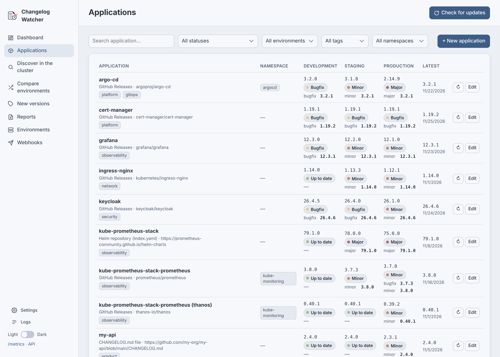
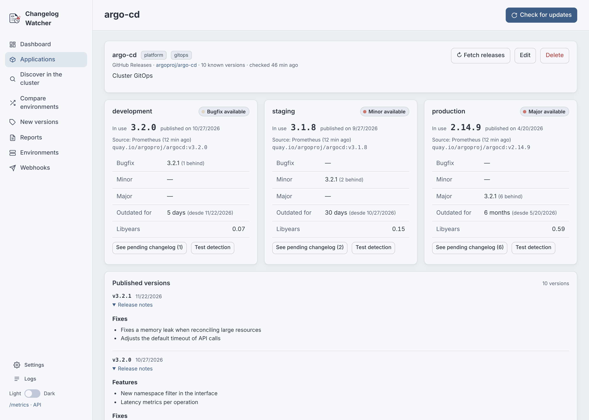
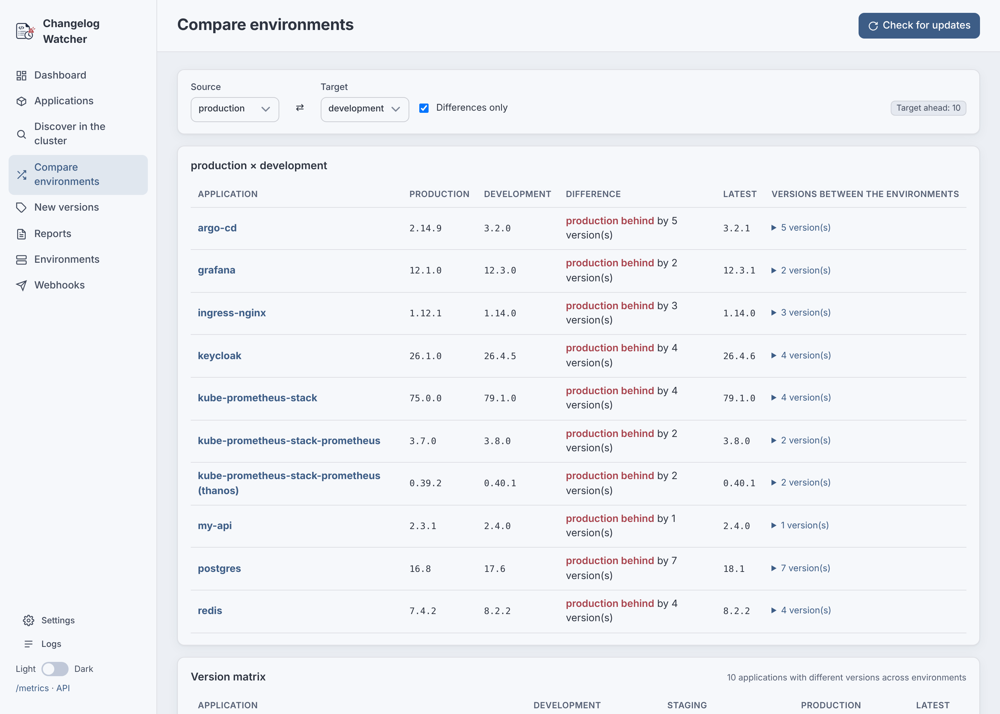
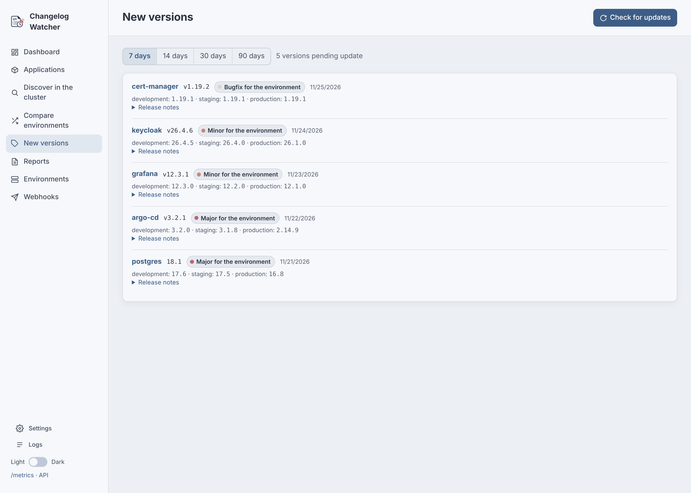
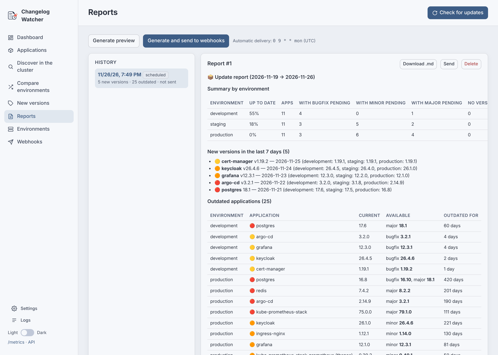
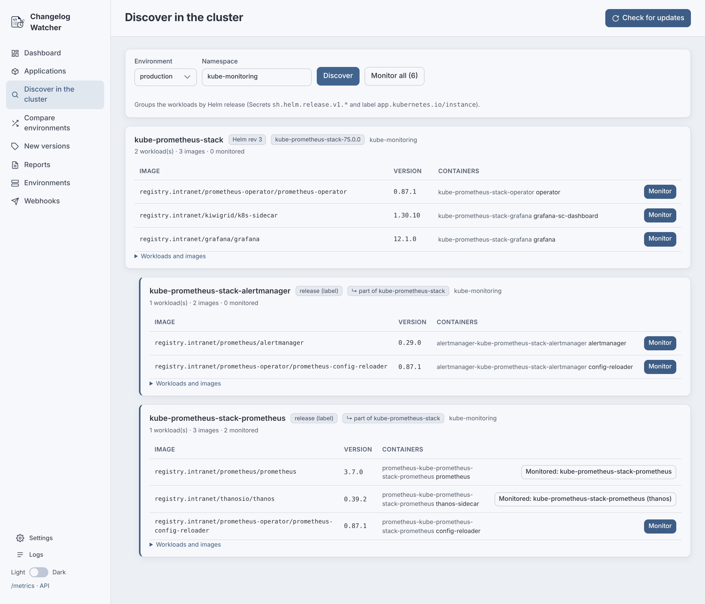

# Changelog Watcher

🇺🇸 English · 🇧🇷 [Português](README.pt-BR.md)

> [!NOTE]
> **Built entirely by AI.** Changelog Watcher was created entirely by an AI, [Claude](https://claude.ai)
> (Anthropic): code, tests, Helm chart, Grafana dashboard and documentation. Keep that in mind
> when using it, and review it before running it in production.

Tracks the changelogs/releases of a list of applications, compares them with the version
running in each environment and tells you what needs updating.

- **Release sources**: GitHub Releases/Tags, GitLab Releases/Tags, Helm repositories
  (`index.yaml`), Docker Hub, `CHANGELOG.md` files or any **web page** that lists the
  versions.
- **Version in use** set manually or **discovered through Prometheus**
  (Deployment/StatefulSet/DaemonSet image via kube-state-metrics), including grouping
  **every workload of a Helm release** as a single application.
- **Cluster discovery**: lists what runs in a namespace grouped by Helm release (with the
  releases created by operators linked to the parent release) and creates one application
  per image in one click, pointing to the repository or releases site.
- **Several environments** (dev, staging, production…), each with its own Prometheus, and
  **version comparison across environments**.
- For each application/environment: the latest **bugfix** of the line in use (I run 1.1.3
  and 1.1.7 exists), the latest **minor** and **major**.
- **Web dashboard**: % of the environment up to date, how many applications are behind by
  bugfix/minor/major, for how long, libyears and the evolution over time.
- **End of life (EOL)** of the cycle in use, looked up on [endoflife.date](https://endoflife.date),
  with a warning when it gets close (90 days by default).
- **Weekly report** sent by webhook (Slack, Microsoft Teams, Discord, Google Chat or
  generic JSON).
- **Prometheus metrics** on `/metrics`, a **Grafana dashboard** and a **Helm chart**
  included.
- Interface, reports and webhooks in **English** (default) or **Portuguese** (see
  [Language](#language)).


## Screens

**Applications**: the version in use in each environment, the largest pending update and
the latest version, with filters by status, environment, tag and namespace.



**Application detail**: per environment, the version in use (manual or detected via
Prometheus, with the image), the available bugfix/minor/major, how long it has been
outdated and the pending changelog; below, every published version with its notes.



**Compare environments**: what is ahead or behind between two environments (e.g.
production × development), with the versions between them, and the version matrix of every
environment.



**New versions**: releases published in the last 7/14/30/90 days that are not in use yet,
with the kind of update and the version of each environment.



**Reports**: the weekly report (summary per environment, new versions and outdated
applications) with the history, the preview and the delivery to the webhooks.



The **Discover in the cluster** screen is in
[Helm releases and cluster discovery](#helm-releases-and-cluster-discovery). The images use
demo data; see [docs/screenshots](docs/screenshots/README.md) to regenerate them.

## How versions are classified

For each deployment (application × environment) the watcher takes every published version
(pre-releases ignored unless enabled) and computes:

| Field | Meaning | Example (1.1.3 in use) |
|---|---|---|
| **bugfix** | highest version with the same `major.minor` | 1.1.7 |
| **minor** | highest version with the same `major` and a higher `minor` | 1.3.1 |
| **major** | highest version with a higher `major` | 2.0.0 |
| **status** | the largest jump available: `up_to_date`, `tolerated`, `patch`, `minor`, `major` or `unknown` | `major` |
| **outdated for** | days since the first version newer than the one in use was published | 200 days |
| **libyears** | years between the publication of the version in use and of the latest one ([libyear](https://libyear.com)) | 1.1 |

Per environment, the dashboard, the report and Grafana show the **average** libyears per
deployment (only those with libyears computed), so that environments with more applications
do not look older just because they have more items. The sum is still exposed in
`environment_libyears_total`.

Higher versions much older than a lower one are ignored (everywhere: status, metrics,
environment comparison and version list): a version is dropped when every version equal to or
higher than it was published more than 2 years before some lower version. E.g. CoreDNS has a
`11.0.0` tag from 2016, while the current line is 1.15 (2026); it does not show up as a
major. Old lines still maintained (PostgreSQL 13 with patches after 14.0) still count,
because there are recent higher versions.

The status is exclusive (each deployment counts once, by its largest jump), but the
dashboard also shows how many deployments have *some* bugfix/minor/major pending — an app in
`major` may also have a bugfix in its line.

Tags like `v1.2.3`, `release-1.2.3`, `chart-1.2.3` and images like `1.25.3-alpine` are
normalized. A single number with a leading zero (`v011`, `007`) is not a version: it is a build
counter (CoreDNS's 2016 tags) and would be read as major 11. Use a **tag pattern** (regex) to
filter monorepo tags and the **`major.bugfix` version scheme** for projects like PostgreSQL,
where `16.2 → 16.9` is a bugfix.

### Outdated tolerance

Keeping everything on the latest version is rarely realistic. A deployment behind only by a
bugfix or a minor, and inside **every** limit that is set, gets the status `tolerated` ("within
tolerance") and is not counted as outdated (dashboard, report, webhooks, outdated delay
metrics). A pending major is always outdated. Each criterion is optional (`off` in the env var, or an
empty field on the Settings page, disables it):

| Criterion | Compared with | Env var | Default |
|---|---|---|---|
| max. days outdated | days since the first newer version | `TOLERANCE_DAYS` | `60` |
| max. minors behind | newer minor lines on the same major (`1.1 → 1.3` = 2) | `TOLERANCE_MINORS` | `1` |
| max. bugfixes behind | newer bugfix versions on the same `major.minor` | `TOLERANCE_BUGFIXES` | `3` |

The env vars are the default, editable on the Settings page (Helm: `config.tolerance`). Each
application can set its own limits; an empty field uses the global value. With no criterion set
the tolerance is off. `app_update_level` keeps the pending update (1 bugfix, 2 minor), while
`app_info{status="tolerated"}` and `environment_apps{status="tolerated"}` mark the tolerated
ones; `environment_up_to_date_ratio` still counts only `up_to_date`.

## End of life (EOL)

On every refresh the watcher looks up [endoflife.date](https://endoflife.date) and warns when
the cycle of the version in use has already lost support (**EOL reached**) or loses it within
`EOL_WARNING_DAYS` days (**EOL soon**, 90 by default ≈ 3 months).

- **Product**: the application's *Product on endoflife.date* field (`eol_product` in the seed),
  the identifier used in the site's URL (`postgresql`, `kubernetes`, `redis`, `nodejs`…). Empty,
  with `EOL_AUTO_MATCH=true`, the application's name and the repository/image/chart name are
  looked up in the product list (with a few aliases: `postgres` → `postgresql`, `node` →
  `nodejs`, `k8s` → `kubernetes`…). `none` disables the check for the application.
- **Cycle**: the most specific cycle that is a prefix of the version in use (`1.29.3` → `1.29`,
  PostgreSQL `13.4` → `13`). A version with no matching cycle has no EOL information.
- `helm_index` sources without *Compare by appVersion* are left out of the automatic lookup: the
  chart version is not the product's (set the product only if the versions match).
- Where it shows up: the "End of life (EOL)" table on the dashboard, an **EOL soon/reached**
  badge in the application list (with a filter), an "End of life" line in the detail, a section
  in the weekly report and in the webhook messages (which then count as "something outdated"
  for `only_outdated`), the `app_eol_*` / `environment_apps_eol` metrics, a Grafana panel and
  the `ChangelogWatcherEndOfLifeSoon` / `ChangelogWatcherEndOfLifeReached` alerts in the
  PrometheusRule.

With NetworkPolicies, endoflife.date needs egress to the internet
(`networkPolicy.internet.enabled`); without access, the application keeps working and the error
shows up in the application detail.

## Version detection via Prometheus

Requires [kube-state-metrics](https://github.com/kubernetes/kube-state-metrics), which
exposes `kube_pod_container_info{namespace, pod, container, image}`.

| Mode | Configuration | Generated query |
|---|---|---|
| `workload` | kind, namespace, name, container (optional) | `kube_pod_container_info{namespace="argocd", pod=~"argocd-server-[a-z0-9]{1,10}-[a-z0-9]{5}", container="server"}` |
| `helm` | namespace and release name; image (optional) picks which image sets the version | pods with `app.kubernetes.io/instance=<release>` (`kube_pod_labels`); without that label, `<release>-*` pods |
| `image` | image repository (or regex) and optional namespace | `kube_pod_container_info{image=~"(.*/)?quay\.io/jetstack/cert-manager-controller(:.*\|@.*)?"}` |
| `query` | free PromQL; the series need the `image` (or `version`) label | `{namespace}` and `{name}` are replaced |

The image tag becomes the version (`quay.io/argoproj/argocd:v2.9.3` → `2.9.3`). During a
rollout the image with more pods wins. Namespace and workload name can be overridden per
environment, and the environment's **extra selector** (e.g. `cluster="prod"`) lets you use a
Thanos/Mimir with several clusters.

The **Test detection** button, on the application page, shows the query and the result
without saving anything.

### Helm releases and cluster discovery

Charts that create several Deployments (Argo CD: server, repo-server, controller, redis…)
become **one application** with the `helm` mode: the version is the image used by most pods of
the release, and on a tie the image named after the release (use **Image** to pin which one,
e.g. `quay.io/argoproj/argocd`, when the release runs third-party images or sidecars).

The **Discover in the cluster** screen queries a namespace (or the whole cluster) and shows the
workloads grouped by release:

- releases come from Helm's storage Secrets (`sh.helm.release.v1.<release>.v<rev>`, metric
  `kube_secret_info`, exported by default);
- each pod joins the release through the `app.kubernetes.io/instance` label or, without it,
  through its name prefix. To use the label (and see `helm.sh/chart`), enable in
  kube-state-metrics:
  `--metric-labels-allowlist=pods=[app.kubernetes.io/instance,helm.sh/chart]`;
- each different **image** of the group can be monitored as its own application (e.g. the
  Prometheus StatefulSet of `kube-prometheus-stack` runs `prometheus`,
  `prometheus-config-reloader` and `thanos`): the suggestion pins the image with **Image**
  (`helm` mode) or **Container** (`workload` mode), and the screen shows which application
  already monitors each image. The main image of the group is the one of most pods; on a tie,
  the one named after the release/workload (`kube-prometheus-stack-prometheus` → `prometheus`);
- groups that are not a Helm release, but belong to one, show up right below it as **part of
  &lt;release&gt;**: pods created by an operator with their own instance label
  (`kube-prometheus-stack-prometheus`, `…-alertmanager`) and whose name starts with the
  release, or pods with an `app.kubernetes.io/part-of`/`release` label pointing to it (add
  these labels to the allowlist above to use them). Subchart workloads show their own
  `helm.sh/chart`.



**Monitor** opens the form already filled in; set where the releases come from: a
GitHub/GitLab repository, a CHANGELOG, a Helm repository or the URL of a **web page**
(`webpage` source: every version found in the text becomes a release; use the **tag pattern**
to ignore versions of other software mentioned on the page and the **CHANGELOG URL** to bring
notes and dates).

Without a repository, the form **suggests the most likely sources** (the **suggest source**
link, automatic when coming from discovery). Click one of them to fill in the form. The
suggestions come, in this order, from:

1. the image's `org.opencontainers.image.source` label, read from the registry with an
   anonymous pull: the official repository, when the image publishes it. Only public
   registries are queried (Docker Hub, ghcr.io, quay.io, gcr.io, registry.k8s.io,
   public.ecr.aws, mcr.microsoft.com, registry.gitlab.com, docker.elastic.co), so the API does
   not reach hosts of the internal network;
2. an internal registry image (e.g. `registry.intranet/nginx:1.30.0`): looks up the public image
   it mirrors, with the same tag (or digest), and uses its label or the Docker Hub image. Tries,
   in this order: the original registry when it is in the path
   (`harbor.corp/proxy/quay.io/org/app` → `quay.io/org/app`), `ghcr.io` and Docker Hub with the
   last two path segments, and the Docker Hub images with the same name that are official or
   have at least 100k pulls;
3. an image on `ghcr.io` → the GitHub repository with the same name;
4. [Artifact Hub](https://artifacthub.io): Helm repositories with a chart of the same name,
   compared by `appVersion` (official or with at least 5 stars);
5. the image on Docker Hub (`dockerhub` source);
6. a GitHub search for repositories with the same name and at least 50 stars, by stars (use
   `GITHUB_TOKEN` to avoid the limit of 10 unauthenticated searches/min).

Artifact Hub and GitHub are searched by chart name (`helm.sh/chart` label), image name and
application name, in this order: the image name tells what actually runs even when the
workload has another name (`frontend` running `nginx`).

Each lookup is independent and takes at most 15 s: if one fails (no internet, private image,
API limit), fewer suggestions show up, and the failure goes to the logs (WARNING). The API is
`GET /api/suggest-source?name=&image=&chart=`.

## Running

### Locally

Requires Python 3.15+.

```bash
pip install -e ".[dev]"
```

```bash
CONFIG_FILE=config.example.yaml changelog-watcher serve
```

Open http://localhost:8080. The API documentation is at `/docs`.

Or with Docker:

```bash
docker compose up --build
```

One-off commands (useful in CronJobs):

```bash
changelog-watcher refresh
```

```bash
changelog-watcher report --send
```

### Kubernetes (Helm)

```bash
helm install changelog-watcher deploy/helm/changelog-watcher -n changelog-watcher --create-namespace -f my-values.yaml
```

Example `my-values.yaml`:

```yaml
config:
  language: en                       # or pt-BR
  publicUrl: https://changelog-watcher.example.com
  reportCron: "0 9 * * mon"
  timezone: America/Sao_Paulo

ingress:
  enabled: true
  className: nginx
  hosts:
    - host: changelog-watcher.example.com
      paths: [{path: /, pathType: Prefix}]

secrets:
  values:
    GITHUB_TOKEN: ghp_xxx              # avoids the GitHub API limit of 60 req/h
    PROM_PROD_TOKEN: xxx
    SLACK_WEBHOOK_URL: https://hooks.slack.com/services/...

metrics:
  serviceMonitor: {enabled: true, labels: {release: kube-prometheus-stack}}
  prometheusRule: {enabled: true}

grafana:
  dashboard: {enabled: true}           # ConfigMap for the Grafana sidecar

seed:
  environments:
    - name: development
      prometheus_url: http://prometheus-dev.monitoring:9090
    - name: production
      prometheus_url: https://thanos.example.com
      prometheus_auth: bearer
      prometheus_token: ${PROM_PROD_TOKEN}
  projects:
    - name: argo-cd
      repository: argoproj/argo-cd
      detection_mode: workload
      workload_namespace: argocd
      workload_name: argocd-server
      deployments: {development: {}, production: {}}
  webhooks:
    - name: slack
      kind: slack
      url: ${SLACK_WEBHOOK_URL}
```

The chart creates the workload (StatefulSet or Deployment, see below), Service, Secret, the
seed ConfigMap and, optionally, Ingress, ServiceMonitor, PrometheusRule, NetworkPolicies and the
dashboard ConfigMap.

The UI/API requires Basic Auth by default (`auth.enabled: true`). Without `auth.password` or
`auth.existingSecret`, the chart generates a random password in the Secret (kept across
upgrades); the command to read it shows up in the `helm install` notes. Use TLS on the Ingress
(`ingress.tls`): the password goes in every request.

#### NetworkPolicies

For clusters that block traffic by default, there are two independent NetworkPolicies (both
off by default, and both allow DNS on port 53):

| Flag | Allows |
|---|---|
| `networkPolicy.prometheus.enabled` | ingress from the Prometheus namespace (`/metrics` scrape) and egress to it (queries, port `9090` by default) |
| `networkPolicy.internet.enabled` | egress to the public internet (`0.0.0.0/0` minus the private networks, cloud metadata `169.254.0.0/16` and loopback in `except`): release sources, webhooks and external Prometheus/Thanos |

```yaml
networkPolicy:
  prometheus:
    enabled: true
    namespaceSelector: {matchLabels: {kubernetes.io/metadata.name: monitoring}}
    allowIngressFrom:                  # who else reaches the UI, e.g. the ingress controller
      - namespaceSelector: {matchLabels: {kubernetes.io/metadata.name: ingress-nginx}}
  internet:
    enabled: true
```

> With `networkPolicy.prometheus` on, the pod only accepts connections from Prometheus and from
> `allowIngressFrom`: without the ingress controller there, the UI is unreachable through the
> Ingress.

The database is always SQLite (external databases are not supported) and the mode is chosen in
`persistence.type`:

| `persistence.type` | Workload | Data when the pod restarts |
|---|---|---|
| `pvc` (default) | StatefulSet with a PVC on `/data` (`1Gi`, StorageClass `gp3`) | **kept** |
| `inMemory` | Deployment without a volume | **lost**: the state goes back to the `seed` only; what was done in the UI, history and reports are gone |

Use `inMemory` for tests only (it is what `values-kind.yaml` uses). The PVC survives a
`helm uninstall`; its size/StorageClass cannot change once created (the StatefulSet's
`volumeClaimTemplates` is immutable), so edit the PVC directly to grow it. To use an existing
PVC, set `persistence.existingClaim`.

> The scheduler (refresh and report) and SQLite run inside the process, so the chart always
> creates **1 replica**.

### Local kind cluster (local image)

Builds the image, loads it into the kind node and installs with
[`deploy/helm/values-kind.yaml`](deploy/helm/values-kind.yaml) (the cluster's own Prometheus,
`pullPolicy: Never`):

```bash
docker build -t changelog-watcher:local .
kind load docker-image changelog-watcher:local --name lab   # your kind cluster name
helm upgrade --install changelog-watcher deploy/helm/changelog-watcher \
  -n changelog-watcher --create-namespace -f deploy/helm/values-kind.yaml
kubectl -n changelog-watcher port-forward svc/changelog-watcher 8080:80   # http://localhost:8080
```

After changing the code: redo `docker build` and `kind load`, and restart with
`kubectl -n changelog-watcher rollout restart deploy/changelog-watcher`.

## Language

The interface, the weekly report, the webhook messages and the API error messages are
available in **English** (default) and **Brazilian Portuguese**:

- installation default: the `APP_LANGUAGE` variable (`en` or `pt-BR`; in Helm, `config.language`);
- the **Settings** page lets you change the language from the UI (the value is saved in the
  database and takes precedence over the variable).

In Helm, `config.language` also picks the language of the Grafana dashboard
(`dashboards/changelog-watcher.json` or `changelog-watcher.pt-BR.json`), of the `helm install`
notes and of the PrometheusRule alerts. Reports already generated keep the language they were
created in; logs and metric descriptions are always in English.

## Configuration

Everything can be managed from the interface. The seed YAML file
([`config.example.yaml`](config.example.yaml)) is optional and meant for GitOps: by default it
only creates what does not exist yet; with `SEED_OVERWRITE=true` it overwrites the fields it
declares.

Secrets (Prometheus tokens, passwords, webhook URLs) can be stored as `${VARIABLE_NAME}` — the
value is read from the environment at use time and never stays in the database. Values typed in
directly are masked in the API responses. Rules:

- the whole field must be the placeholder (`${SLACK_WEBHOOK_URL}`); a placeholder in the middle
  of a text (`https://host/${X}`) is not expanded, so it cannot be sent to an arbitrary host;
- the application's own credentials (`AUTH_*`, `GITHUB_TOKEN`, `GITLAB_TOKEN`, `METRICS_TOKEN`,
  `DATABASE_URL`) are never expanded;
- when the Prometheus URL of an environment changes, the masked token/password must be entered
  again.

Requests to configured URLs (sources, Prometheus, webhooks, redirects included) are refused when
the host resolves to loopback or link-local (cloud metadata, `169.254.169.254`). Private
networks are still allowed.

| Variable | Default | Description |
|---|---|---|
| `DATABASE_URL` | `sqlite:///./data/changelog-watcher.db` | SQLite database (the only one supported); `sqlite:///:memory:` = in memory, data lost on restart |
| `CONFIG_FILE` | — | seed YAML |
| `SEED_OVERWRITE` | `false` | the seed overwrites changes made in the UI |
| `GITHUB_TOKEN` / `GITHUB_API_URL` | — / `https://api.github.com` | token and API (GitHub Enterprise); the token is only sent to that API (and to `raw.githubusercontent.com`), never to an application's `source_url` |
| `GITLAB_TOKEN` / `GITLAB_URL` | — / `https://gitlab.com` | GitLab token and URL; the token is only sent to that URL |
| `REFRESH_INTERVAL_MINUTES` | `360` | interval of the automatic refresh (0 disables it); default, editable on the Settings page |
| `REFRESH_ON_STARTUP` | `true` | refresh on start |
| `REPORT_CRON` | `0 9 * * mon` | cron of the weekly report; default, editable on the Settings page |
| `REPORT_DAYS` | `7` | "new versions" window of the report |
| `REPORT_SEND_ENABLED` | `true` | sends the scheduled report to the webhooks |
| `TZ` | `UTC` | scheduler time zone |
| `PUBLIC_URL` | — | link to the UI included in the report |
| `APP_LANGUAGE` | `en` | interface, report and webhook language (`en` or `pt-BR`); default, editable on the Settings page |
| `MAX_RELEASE_PAGES` | `3` | pages of 100 releases/tags fetched per source |
| `EOL_ENABLED` | `true` | looks up the end of life (EOL) on endoflife.date on every refresh |
| `EOL_API_URL` | `https://endoflife.date/api` | endoflife.date API (or a mirror) |
| `EOL_WARNING_DAYS` | `90` | warns "EOL soon" when at most N days are left |
| `EOL_AUTO_MATCH` | `true` | without a product set, looks the application's name/repository up |
| `TOLERANCE_DAYS` / `TOLERANCE_MINORS` / `TOLERANCE_BUGFIXES` | `60` / `1` / `3` | [outdated tolerance](#outdated-tolerance); `off` disables the criterion; editable on the Settings page |
| `AUTH_USERNAME` / `AUTH_PASSWORD` | — | basic auth on the UI/API, required (`/healthz` and `/readyz` stay open); without them the application does not start |
| `AUTH_DISABLED` | `false` | `true` runs without authentication (local tests only) |
| `METRICS_TOKEN` | — | bearer token required on `/metrics`; empty = open |
| `SCHEDULER_ENABLED` | `true` | disables the internal scheduler |
| `METRICS_CACHE_SECONDS` | `30` | cache of the computed metrics |

### Creating the tokens

All of them are optional, but recommended. Never commit the value: pass it as an environment
variable (or Kubernetes Secret) and, in the UI/seed fields, reference it as `${NAME}`.

**`GITHUB_TOKEN`** — avoids the API limit of 60 requests/hour and allows reading private
repositories.

1. GitHub → *Settings* → *Developer settings* → *Personal access tokens* → *Fine-grained tokens* → *Generate new token*.
2. Set an expiration and, under *Repository access*, choose *Public repositories (read-only)*.
   For private repositories, select them and grant the *Contents: Read-only* permission.
3. Copy the token (`github_pat_…`) and export `GITHUB_TOKEN`. A *classic* token without any
   scope also works for public repositories (for private ones, use the `repo` scope).
4. GitHub Enterprise: generate the token on your instance and also set `GITHUB_API_URL` (the
   token only goes to that URL; an application's `source_url` never receives it).

**`GITLAB_TOKEN`** — GitLab → *Preferences* → *Access Tokens* (or *Settings → Access Tokens* of
a project/group) with the `read_api` scope. For self-managed installations, set `GITLAB_URL`.

**Prometheus token** (*token* field of an environment with `bearer` authentication) — only
needed if Prometheus/Thanos is behind authentication. Use a read token of your infrastructure,
for example:

- Prometheus exposed through a proxy with a ServiceAccount (OpenShift, oauth2-proxy):
  `kubectl create token <serviceaccount> -n <namespace> --duration=8760h`, with read/query
  permission only.
- Managed services (Grafana Cloud, Thanos/Mimir with a gateway): the service's own read API token.

A Prometheus without authentication (e.g. kube-prometheus-stack reached inside the cluster) uses
`none` and needs no token.

## Webhooks

| Kind | Payload sent |
|---|---|
| `slack` | `{"text": …}` with mrkdwn |
| `teams` | Adaptive Card (Workflows / Power Automate) |
| `discord` | `{"content": …}`, split into messages of up to 2000 characters |
| `google_chat` | `{"text": …}` |
| `generic` | `{"event": "changelog_watcher.report", "markdown": …, "report": {…}}` with all the data |

Each webhook can be limited to some environments and set to send only when there are outdated
applications. The report contains: a summary per environment, the week's new versions (marked by
their impact on what is deployed), outdated applications with the available
bugfix/minor/major, the end of life (EOL) section, applications without an identified version
and differences between environments. Reports are saved and can be downloaded as Markdown.

## Metrics

All prefixed with `changelog_watcher_`, computed from the database on each scrape:

| Metric | Labels | Description |
|---|---|---|
| `app_info` | project, environment, current_version, latest_version, latest_patch, latest_minor, latest_major, status, version_source | always 1 |
| `app_update_level` | project, environment | -1 unknown, 0 up to date, 1 bugfix, 2 minor, 3 major |
| `app_update_available` | project, environment, type | 1 if an update of the type is available |
| `app_versions_behind` | project, environment, type (`patch`/`minor`/`major`/`total`) | versions behind |
| `app_outdated_days` | project, environment | days since the first newer version |
| `app_libyears` | project, environment | libyears |
| `app_detection_error` | project, environment | 1 if the Prometheus detection failed |
| `environment_apps` | environment, status | deployments by status |
| `environment_apps_pending` | environment, type | deployments with an update of the type (not exclusive) |
| `environment_up_to_date_ratio` | environment | up-to-date fraction |
| `environment_apps_total` | environment | total deployments |
| `environment_libyears_total` | environment | sum of libyears |
| `environment_libyears_avg` | environment | average libyears per deployment (only deployments with libyears computed) |
| `app_eol_level` | project, environment, product, cycle | 0 supported, 1 EOL soon, 2 EOL reached |
| `app_eol_days_left` | project, environment, product, cycle | days until the end of life (negative: already past) |
| `environment_apps_eol` | environment, status (`soon`/`eol`) | deployments with EOL soon/reached |
| `environment_outdated_days_avg` / `_max` | environment | average/maximum delay |
| `environment_versions_behind_total` | environment | sum of versions behind |
| `environment_apps_by_age` | environment, bucket | outdated deployments by delay bucket |
| `environment_pair_different_apps` | source_environment, target_environment | apps with different versions between two environments |
| `project_version_mismatch` / `project_distinct_versions` | project | drift across environments |
| `release_latest_timestamp_seconds` | project, version | publication of the latest version |
| `releases_last_7d` | project | versions published in the week |
| `project_source_error` | project, source_type | 1 if the last fetch failed |
| `last_refresh_timestamp_seconds` / `last_refresh_success` | — | collection health |
| `refresh_duration_seconds`, `refresh_runs_total`, `source_fetches_total`, `prometheus_detections_total` | — | process counters/histogram |

### Grafana

The dashboard is at
[`deploy/helm/changelog-watcher/dashboards/changelog-watcher.json`](deploy/helm/changelog-watcher/dashboards/changelog-watcher.json)
(in Portuguese: [`changelog-watcher.pt-BR.json`](deploy/helm/changelog-watcher/dashboards/changelog-watcher.pt-BR.json);
import it in the UI or use `grafana.dashboard.enabled` in Helm, which picks it by
`config.language`). It has environment and application filters and shows: % up to date,
bugfix/minor/major pending, libyears, status per environment, delay buckets, evolution over
time, a version table with the available updates, a version matrix across environments, drift
between environment pairs, status history per application, end of life (EOL), new versions and
collection failures.

The JSON files are generated by [`deploy/grafana/build_dashboard.py`](deploy/grafana/build_dashboard.py);
edit the script and run it to update both files.

The optional `PrometheusRule` brings alerts for a major version pending for more than N days,
end of life soon/reached, detection failure and stalled collection.

## Architecture

```
changelog_watcher/
  sources/      release sources (github, gitlab, helm, dockerhub, changelog, web page)
  prometheus.py detection of the version in use via kube_pod_container_info
  versioning.py version parsing and bugfix/minor/major classification
  analysis.py   status per deployment, summaries, environment comparison
  refresh.py    pipeline: detection → releases → EOL → daily snapshot
  eol.py        end of life from endoflife.date
  report.py     report (data + Markdown)
  i18n.py       language (English/Portuguese) and backend message catalog
  webhooks.py   Slack/Teams/Discord/Google Chat/generic formats
  metrics.py    Prometheus collector
  api.py        REST API (FastAPI)
  static/       frontend (HTML/JS/CSS, no build step; texts in i18n.js)
deploy/
  helm/changelog-watcher/   Helm chart
  grafana/                  Grafana dashboard
```

A daily snapshot per environment feeds the UI's evolution charts; in Grafana the history comes
from Prometheus itself.

## Known limitations

- **Docker Hub** does not tell the original publication date of a tag, only the last push —
  rebuilt images (e.g. CVE fixes) may have newer dates. Without `tag_pattern`, only "pure"
  version tags are considered (variants like `-alpine` are ignored; the version in use
  `1.25.3-alpine` becomes `1.25.3`).
- The GitHub API without a token allows 60 requests/hour — set `GITHUB_TOKEN`.
- Paginated sources (`MAX_RELEASE_PAGES`) only look at the N×100 most recent versions. Very old
  versions in use may have no date (libyears not computed).
- Database migrations only add new columns; there is no removal/renaming.

## Development

```bash
pytest -q
pytest -q --cov    # tests with coverage (minimum in pyproject.toml)
ruff check .
```

```bash
python deploy/grafana/build_dashboard.py
```

```bash
helm lint deploy/helm/changelog-watcher
```

New user-facing text goes in English, with its pt-BR translation: in the backend, wrap it in
`_()` and add it to `changelog_watcher/i18n.py`; in the UI, use `t()` and add it to
`changelog_watcher/static/i18n.js` (`tests/test_i18n.py` checks both catalogs). Documentation is
kept in both languages (`README.md` and `README.pt-BR.md`).

### Versioning and releases

The application image and the Helm chart have **separate versions**, each with its own tag
pattern:

| Component | Changes when you change | Tag and release | Files updated |
|---|---|---|---|
| Image | `changelog_watcher/`, `Dockerfile`, `.dockerignore`, `pyproject.toml` | `vX.Y.Z` + image on GHCR | `version` in `pyproject.toml`, `appVersion` in `Chart.yaml` |
| Helm chart | `deploy/helm/changelog-watcher/` | `chart-vX.Y.Z` | `version` in `Chart.yaml` |

A new image changes `appVersion` (the chart's default image), so it also produces a chart
version: a patch, if the chart itself did not change. Documentation, tests and CI **do not
produce a version**: changes to the READMEs and `docs/` wait for the next image or chart release
and go into its notes. The `vX.Y.Z` tags before the split applied to both; the chart starts from
them until the first `chart-vX.Y.Z` exists.

Versions use `vX.Y.Z` (with `v`) in `Chart.yaml`, tags, the image and the release.
`pyproject.toml` follows the pip standard, without `v` (`X.Y.Z`, rc as `X.Y.ZrcN`).

Every PR runs the `ci` workflow (tests, dashboard and Helm); the result of each test shows up in
the run summary on GitHub Actions and in a PR comment (updated on every push). Each merge into
`main` runs the `release` workflow, which first runs `ci` and only then, for each component
changed since its last tag:

1. the Copilot CLI reads the component's changes (commits, files and diff, plus the READMEs and
   `docs/`) and writes up to 3 topics describing what changed (the release notes);
2. the version comes from the **name of the PR's branch**:
   - `release-vX.Y.Z` (e.g. `release-v1.2.0`): the release is `vX.Y.Z` for the image and
     `chart-vX.Y.Z` for the chart. The workflow fails if `vX.Y.Z` is not higher than the image's
     last tag; if the chart is already at or past it, the chart gets a patch instead;
   - any other branch (or a direct push) is a **bugfix**: the last tag gets a patch bump, unless
     the component's file (`pyproject.toml`/`appVersion` for the image, `version` in `Chart.yaml`
     for the chart) or, for the image only, a `vX.Y.Z-rcN` tag holds a higher version (the highest
     wins, always without the `-rcN` suffix: `v0.2.0-rc3` → `v0.2.0`);
3. if `pyproject.toml` or `Chart.yaml` are out of date, the workflow commits the fix
   (`chore(release): vX.Y.Z, chart-vX.Y.Z [skip ci]`);
4. creates the tags; for the image it publishes `ghcr.io/andresantiiago/changelog-watcher` with
   the `vX.Y.Z`, `vX.Y`, `latest` and `sha-<commit>` tags; and creates the GitHub releases with
   Copilot's description (or the subjects of the component's commits since its last tag, if
   Copilot fails). The chart release is not marked as "Latest".

During development, creating a `vX.Y.Z-rcN` tag (e.g. `git tag v0.2.0-rc1 && git push origin v0.2.0-rc1`)
publishes the `vX.Y.Z-rcN` image (without touching `latest`) and a GitHub pre-release, with no
commit on `main`. On the next merge the release comes out as `vX.Y.Z`.

The chart uses `appVersion` as the image tag, so each chart version points to the latest image
at the date of its release. The workflow uses the `GH_TOKEN` secret: a fine-grained token with
**Contents** (write, for the commit and the tags) and **Copilot Requests**.
