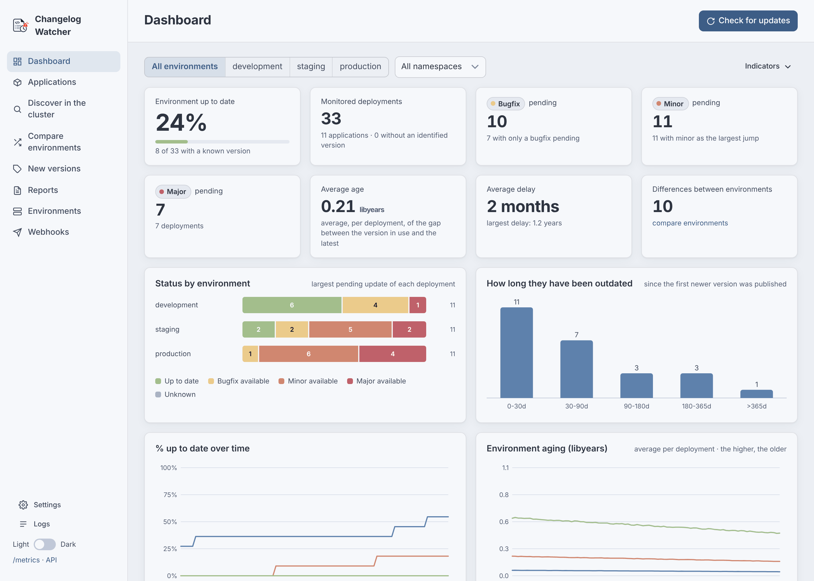

# Changelog Watcher

Acompanha os changelogs/releases de uma lista de aplicações, compara com a versão
que está rodando em cada ambiente e avisa o que precisa ser atualizado.

- **Fontes de releases**: GitHub Releases/Tags, GitLab Releases/Tags, repositórios
  Helm (`index.yaml`), Docker Hub, arquivos `CHANGELOG.md` ou qualquer **página web**
  que liste as versões.
- **Versão em uso** informada manualmente ou **descoberta pelo Prometheus**
  (imagem do Deployment/StatefulSet/DaemonSet via kube-state-metrics), inclusive
  agrupando **todos os workloads de um release Helm** como uma única aplicação.
- **Descoberta no cluster**: lista o que roda num namespace agrupado por release
  Helm e cria a aplicação com um clique, apontando para o repositório ou site de releases.
- **Vários ambientes** (dev, homologação, produção…), cada um com seu Prometheus,
  e **comparação de versões entre ambientes**.
- Para cada aplicação/ambiente: **bugfix** mais recente da linha em uso
  (estou na 1.1.3 e existe a 1.1.7), **minor** e **major** mais recentes.
- **Dashboard web**: % do ambiente atualizado, quantas aplicações estão atrás por
  bugfix/minor/major, há quanto tempo, libyears e a evolução ao longo do tempo.
- **Relatório semanal** enviado por webhook (Slack, Microsoft Teams, Discord,
  Google Chat ou JSON genérico).
- **Métricas Prometheus** em `/metrics`, **dashboard do Grafana** e **chart Helm**
  inclusos.



## Como as versões são classificadas

Para cada implantação (aplicação × ambiente) o watcher pega todas as versões
publicadas (pre-releases ignoradas, a menos que habilitado) e calcula:

| Campo | Significado | Exemplo (em uso 1.1.3) |
|---|---|---|
| **bugfix** | maior versão com o mesmo `major.minor` | 1.1.7 |
| **minor** | maior versão com o mesmo `major` e `minor` maior | 1.3.1 |
| **major** | maior versão com `major` maior | 2.0.0 |
| **status** | o maior salto disponível: `up_to_date`, `patch`, `minor`, `major` ou `unknown` | `major` |
| **atrasada há** | dias desde a publicação da primeira versão mais nova que a em uso | 200 dias |
| **libyears** | anos entre a publicação da versão em uso e a da mais recente ([libyear](https://libyear.com)) | 1,1 |

O status é exclusivo (cada implantação conta uma vez, pelo maior salto), mas o
dashboard também mostra quantas implantações têm *algum* bugfix/minor/major
pendente — uma app em `major` pode ter também um bugfix na sua linha.

Tags como `v1.2.3`, `release-1.2.3`, `chart-1.2.3` e imagens como
`1.25.3-alpine` são normalizadas. Use **padrão de tag** (regex) para filtrar
tags de monorepos e **esquema de versão `major.bugfix`** para projetos como o
PostgreSQL, em que `16.2 → 16.9` é bugfix.

## Detecção da versão via Prometheus

Requer [kube-state-metrics](https://github.com/kubernetes/kube-state-metrics),
que expõe `kube_pod_container_info{namespace, pod, container, image}`.

| Modo | Configuração | Consulta gerada |
|---|---|---|
| `workload` | tipo, namespace, nome, container (opcional) | `kube_pod_container_info{namespace="argocd", pod=~"argocd-server-[a-z0-9]{1,10}-[a-z0-9]{5}", container="server"}` |
| `helm` | namespace e nome do release; imagem (opcional) escolhe qual imagem define a versão | pods com `app.kubernetes.io/instance=<release>` (`kube_pod_labels`); sem esse label, pods `<release>-*` |
| `image` | repositório da imagem (ou regex) e namespace opcional | `kube_pod_container_info{image=~"(.*/)?quay\.io/jetstack/cert-manager-controller(:.*\|@.*)?"}` |
| `query` | PromQL livre; as séries precisam do label `image` (ou `version`) | `{namespace}` e `{name}` são substituídos |

A tag da imagem vira a versão (`quay.io/argoproj/argocd:v2.9.3` → `2.9.3`). Durante
um rollout vence a imagem com mais pods. Em cada ambiente é possível sobrescrever
namespace e nome do workload, e o **seletor extra** do ambiente (ex.
`cluster="prod"`) permite usar um Thanos/Mimir com vários clusters.

O botão **Testar detecção**, na página da aplicação, mostra a consulta e o
resultado sem salvar nada.

### Releases Helm e descoberta no cluster

Charts que criam vários Deployments (Argo CD: server, repo-server, controller,
redis…) viram **uma aplicação** com o modo `helm`: a versão é a imagem usada pela
maioria dos pods do release (use **Imagem** para fixar qual delas, ex.
`quay.io/argoproj/argocd`, quando o release roda imagens de terceiros).

A tela **Descobrir no cluster** consulta um namespace (ou o cluster todo) e mostra
os workloads agrupados por release:

- os releases vêm dos Secrets de armazenamento do Helm (`sh.helm.release.v1.<release>.v<rev>`,
  métrica `kube_secret_info`, exportada por padrão);
- cada pod entra no release pelo label `app.kubernetes.io/instance` ou, sem ele,
  pelo prefixo do nome. Para usar o label (e ver o `helm.sh/chart`), habilite no
  kube-state-metrics:
  `--metric-labels-allowlist=pods=[app.kubernetes.io/instance,helm.sh/chart]`.

**Monitorar** abre o formulário já preenchido; informe de onde vêm as releases:
repositório GitHub/GitLab, CHANGELOG, repositório Helm ou a URL de uma **página
web** (fonte `webpage`: toda versão encontrada no texto vira uma release; use o
**padrão de tag** para ignorar versões de outros softwares citadas na página e a
**URL do CHANGELOG** para trazer notas e datas). Imagens do `ghcr.io` já sugerem o
repositório GitHub.

## Executando

### Local

```bash
pip install -e ".[dev]"
```

```bash
CONFIG_FILE=config.example.yaml changelog-watcher serve
```

Abra http://localhost:8080. A documentação da API fica em `/docs`.

Ou com Docker:

```bash
docker compose up --build
```

Comandos avulsos (úteis em CronJobs):

```bash
changelog-watcher refresh
```

```bash
changelog-watcher report --send
```

### Kubernetes (Helm)

```bash
helm install changelog-watcher deploy/helm/changelog-watcher -n changelog-watcher --create-namespace -f meus-valores.yaml
```

Exemplo de `meus-valores.yaml`:

```yaml
config:
  publicUrl: https://changelog-watcher.empresa.com
  reportCron: "0 9 * * mon"
  timezone: America/Sao_Paulo

ingress:
  enabled: true
  className: nginx
  hosts:
    - host: changelog-watcher.empresa.com
      paths: [{path: /, pathType: Prefix}]

secrets:
  values:
    GITHUB_TOKEN: ghp_xxx              # evita o limite de 60 req/h da API do GitHub
    PROM_PROD_TOKEN: xxx
    SLACK_WEBHOOK_URL: https://hooks.slack.com/services/...

metrics:
  serviceMonitor: {enabled: true, labels: {release: kube-prometheus-stack}}
  prometheusRule: {enabled: true}

grafana:
  dashboard: {enabled: true}           # ConfigMap para o sidecar do Grafana

seed:
  environments:
    - name: desenvolvimento
      prometheus_url: http://prometheus-dev.monitoring:9090
    - name: producao
      prometheus_url: https://thanos.empresa.com
      prometheus_auth: bearer
      prometheus_token: ${PROM_PROD_TOKEN}
  projects:
    - name: argo-cd
      repository: argoproj/argo-cd
      detection_mode: workload
      workload_namespace: argocd
      workload_name: argocd-server
      deployments: {desenvolvimento: {}, producao: {}}
  webhooks:
    - name: slack
      kind: slack
      url: ${SLACK_WEBHOOK_URL}
```

O chart cria Deployment, Service, PVC (SQLite), Secret, ConfigMap do seed e,
opcionalmente, Ingress, ServiceMonitor, PrometheusRule e o ConfigMap do dashboard.
Para PostgreSQL use `database.url` ou `database.existingSecret`.

> O agendador (atualização e relatório) roda dentro do processo. Mantenha
> `replicaCount: 1` — com mais réplicas o relatório seria enviado por cada uma.
> O chart bloqueia mais de uma réplica com SQLite.

## Configuração

Tudo pode ser gerenciado pela interface. O arquivo YAML de seed
([`config.example.yaml`](config.example.yaml)) é opcional e serve para GitOps:
por padrão ele só cria o que ainda não existe; com `SEED_OVERWRITE=true` ele
sobrescreve os campos que declara.

Segredos (tokens do Prometheus, senhas, URLs de webhook) podem ser gravados como
`${NOME_DA_VARIAVEL}` — o valor é lido do ambiente na hora do uso e nunca fica no
banco. Valores digitados diretamente são mascarados nas respostas da API.

| Variável | Padrão | Descrição |
|---|---|---|
| `DATABASE_URL` | `sqlite:///./data/changelog-watcher.db` | SQLAlchemy URL (`postgresql+psycopg://…` também funciona) |
| `CONFIG_FILE` | — | YAML de seed |
| `SEED_OVERWRITE` | `false` | seed sobrescreve alterações feitas pela UI |
| `GITHUB_TOKEN` / `GITHUB_API_URL` | — / `https://api.github.com` | token e API (GitHub Enterprise) |
| `GITLAB_TOKEN` / `GITLAB_URL` | — / `https://gitlab.com` | token e URL do GitLab |
| `REFRESH_INTERVAL_MINUTES` | `360` | intervalo da busca automática (0 desativa) |
| `REFRESH_ON_STARTUP` | `true` | busca ao iniciar |
| `REPORT_CRON` | `0 9 * * mon` | cron do relatório semanal |
| `REPORT_DAYS` | `7` | janela de "novas versões" do relatório |
| `REPORT_SEND_ENABLED` | `true` | envia o relatório agendado aos webhooks |
| `TZ` | `UTC` | fuso do agendador |
| `PUBLIC_URL` | — | link para a UI incluído no relatório |
| `MAX_RELEASE_PAGES` | `3` | páginas de 100 releases/tags buscadas por fonte |
| `MAX_TAG_DATE_LOOKUPS` | `25` | commits consultados para datar tags do GitHub |
| `AUTH_USERNAME` / `AUTH_PASSWORD` | — | basic auth na UI/API (`/metrics` e `/healthz` ficam abertos) |
| `SCHEDULER_ENABLED` | `true` | desativa o agendador interno |
| `METRICS_CACHE_SECONDS` | `30` | cache das métricas calculadas |

## Webhooks

| Tipo | Formato enviado |
|---|---|
| `slack` | `{"text": …}` com mrkdwn |
| `teams` | Adaptive Card (Workflows / Power Automate) |
| `discord` | `{"content": …}`, quebrado em mensagens de até 2000 caracteres |
| `google_chat` | `{"text": …}` |
| `generic` | `{"event": "changelog_watcher.report", "markdown": …, "report": {…}}` com todos os dados |

Cada webhook pode ser limitado a alguns ambientes e configurado para só enviar
quando houver aplicações desatualizadas. O relatório contém: resumo por
ambiente, novas versões da semana (marcadas pelo impacto em relação ao que está
implantado), aplicações desatualizadas com bugfix/minor/major disponíveis,
aplicações sem versão identificada e diferenças entre ambientes. Relatórios
ficam salvos e podem ser baixados em Markdown.

## Métricas

Todas com prefixo `changelog_watcher_`, calculadas a partir do banco a cada scrape:

| Métrica | Labels | Descrição |
|---|---|---|
| `app_info` | project, environment, current_version, latest_version, latest_patch, latest_minor, latest_major, status, version_source | sempre 1 |
| `app_update_level` | project, environment | -1 desconhecido, 0 atualizado, 1 bugfix, 2 minor, 3 major |
| `app_update_available` | project, environment, type | 1 se há atualização do tipo |
| `app_versions_behind` | project, environment, type (`patch`/`minor`/`major`/`total`) | versões atrás |
| `app_outdated_days` | project, environment | dias desde a primeira versão mais nova |
| `app_libyears` | project, environment | libyears |
| `app_detection_error` | project, environment | 1 se a detecção via Prometheus falhou |
| `environment_apps` | environment, status | implantações por status |
| `environment_apps_pending` | environment, type | implantações com atualização do tipo (não exclusivo) |
| `environment_up_to_date_ratio` | environment | fração atualizada |
| `environment_apps_total` | environment | total de implantações |
| `environment_libyears_total` | environment | soma de libyears |
| `environment_outdated_days_avg` / `_max` | environment | atraso médio/máximo |
| `environment_versions_behind_total` | environment | soma de versões atrás |
| `environment_apps_by_age` | environment, bucket | desatualizadas por faixa de atraso |
| `environment_pair_different_apps` | source_environment, target_environment | apps com versões diferentes entre dois ambientes |
| `project_version_mismatch` / `project_distinct_versions` | project | divergência entre ambientes |
| `release_latest_timestamp_seconds` | project, version | publicação da versão mais recente |
| `releases_last_7d` | project | versões publicadas na semana |
| `project_source_error` | project, source_type | 1 se a última coleta falhou |
| `last_refresh_timestamp_seconds` / `last_refresh_success` | — | saúde da coleta |
| `refresh_duration_seconds`, `refresh_runs_total`, `source_fetches_total`, `prometheus_detections_total` | — | contadores/histograma do processo |

### Grafana

O dashboard está em
[`deploy/helm/changelog-watcher/dashboards/changelog-watcher.json`](deploy/helm/changelog-watcher/dashboards/changelog-watcher.json)
(importe pela UI ou use `grafana.dashboard.enabled` no Helm). Ele tem filtros de
ambiente e aplicação e mostra: % atualizado, pendências de bugfix/minor/major,
libyears, status por ambiente, faixas de atraso, evolução no tempo, tabela de
versões com as atualizações disponíveis, matriz de versões entre ambientes,
divergências entre pares de ambientes, histórico de status por aplicação, novas
versões e falhas de coleta.

O JSON é gerado por [`deploy/grafana/build_dashboard.py`](deploy/grafana/build_dashboard.py);
edite o script e rode-o para atualizar o JSON.

O `PrometheusRule` opcional traz alertas para versão major pendente há mais de N
dias, falha de detecção e coleta parada.

## Arquitetura

```
changelog_watcher/
  sources/      fontes de releases (github, gitlab, helm, dockerhub, changelog, página web)
  prometheus.py detecção da versão em uso via kube_pod_container_info
  versioning.py parsing de versões e classificação bugfix/minor/major
  analysis.py   status por implantação, resumos, comparação entre ambientes
  refresh.py    pipeline: detecção → releases → snapshot diário
  report.py     relatório (dados + Markdown)
  webhooks.py   formatos Slack/Teams/Discord/Google Chat/genérico
  metrics.py    collector Prometheus
  api.py        API REST (FastAPI)
  static/       frontend (HTML/JS/CSS, sem build)
deploy/
  helm/changelog-watcher/   chart Helm
  grafana/                  dashboard do Grafana
```

Um snapshot diário por ambiente alimenta os gráficos de evolução da UI; no
Grafana o histórico vem do próprio Prometheus.

## Limitações conhecidas

- **Docker Hub** não informa a data de publicação original da tag, só a do último
  push — imagens reconstruídas (ex.: correções de CVE) podem ter datas mais
  recentes. Sem `tag_pattern`, só tags de versão "puras" são consideradas
  (variações como `-alpine` são ignoradas; a versão em uso `1.25.3-alpine` vira
  `1.25.3`).
- A API do GitHub sem token permite 60 requisições/hora — configure `GITHUB_TOKEN`.
- Fontes paginadas (`MAX_RELEASE_PAGES`) só olham as N×100 versões mais recentes.
  Versões em uso muito antigas podem ficar sem data (libyears não calculado).
- As migrações de banco só adicionam colunas novas; não há remoção/renomeação.

## Desenvolvimento

```bash
pytest -q
```

```bash
python deploy/grafana/build_dashboard.py
```

```bash
helm lint deploy/helm/changelog-watcher
```
