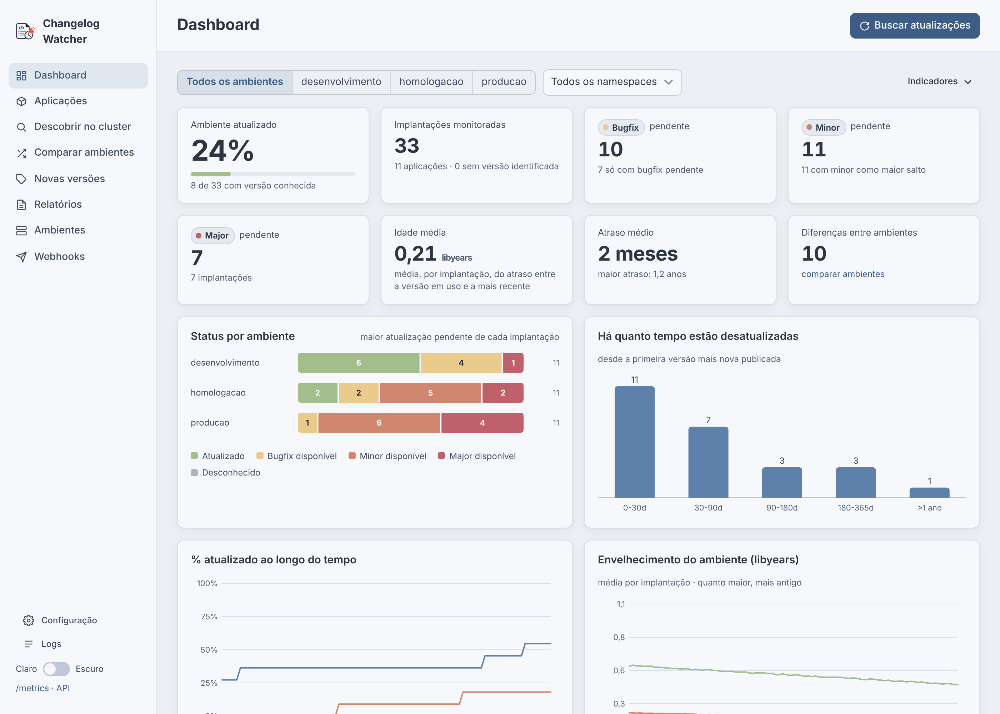
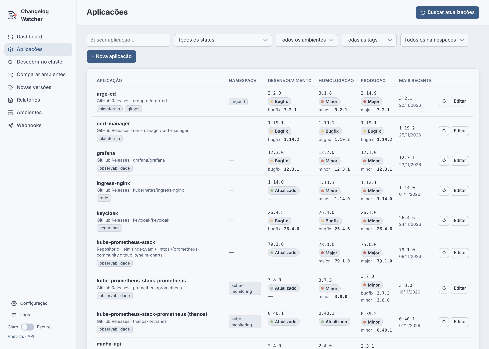
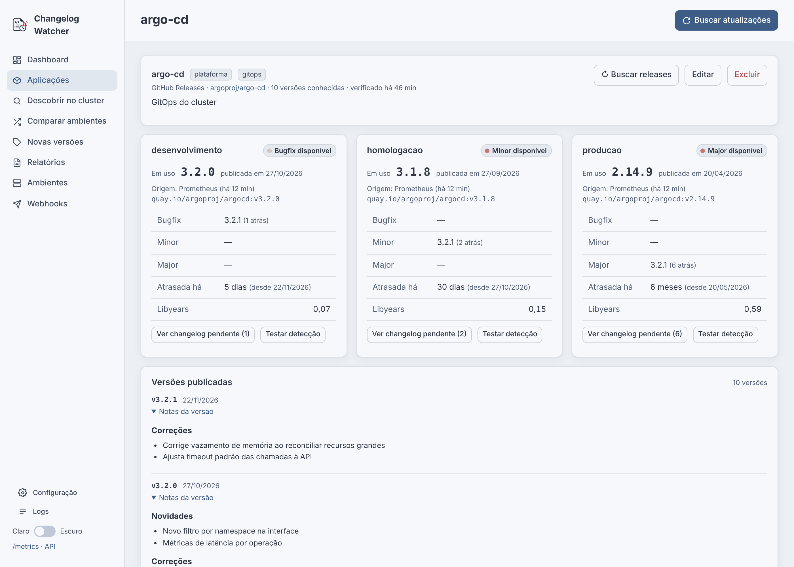
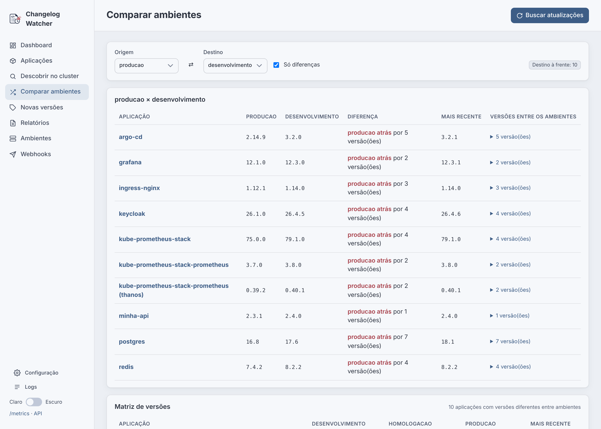
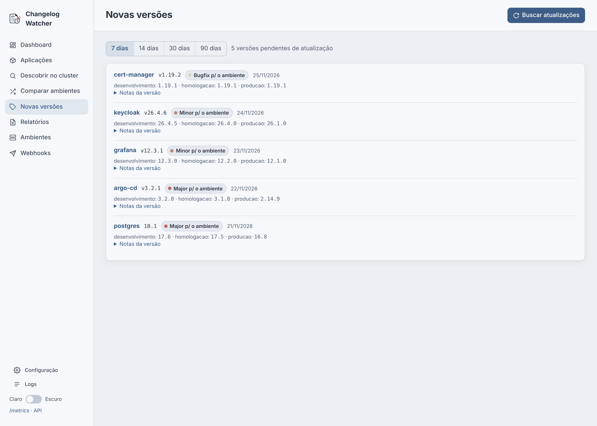
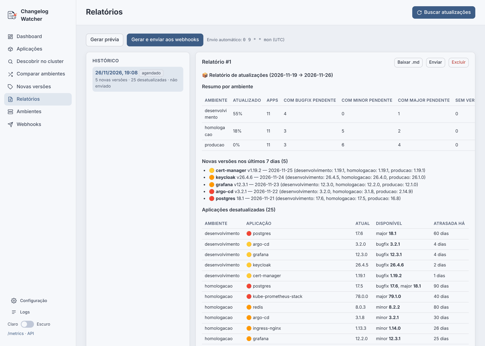
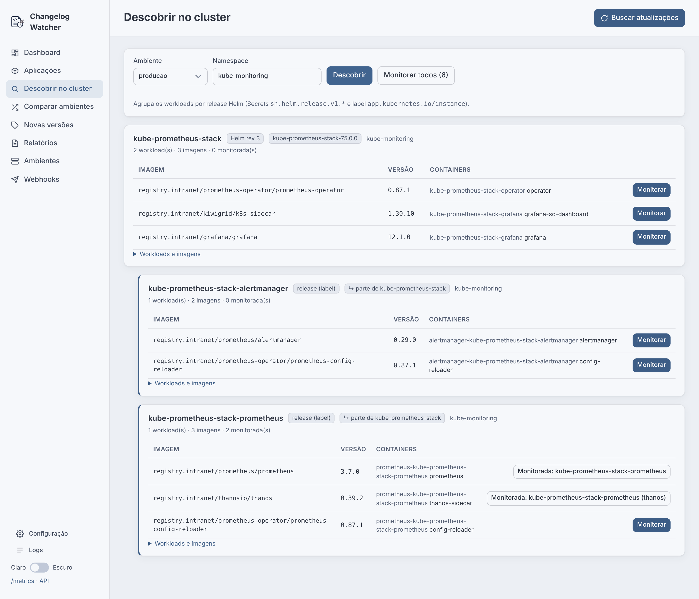

# Changelog Watcher

🇺🇸 [English](README.md) · 🇧🇷 Português

> [!NOTE]
> **Criado inteiramente por IA.** O Changelog Watcher foi criado inteiramente por uma IA, o
> [Claude](https://claude.ai) (Anthropic): código, testes, chart Helm, dashboard do Grafana e
> documentação. Leve isso em conta ao utilizá-lo e revise-o antes de colocá-lo em produção.

Acompanha os changelogs/releases de uma lista de aplicações, compara com a versão
que está rodando em cada ambiente e avisa o que precisa ser atualizado.

- **Fontes de releases**: GitHub Releases/Tags, GitLab Releases/Tags, repositórios
  Helm (`index.yaml`), Docker Hub, arquivos `CHANGELOG.md` ou qualquer **página web**
  que liste as versões.
- **Versão em uso** informada manualmente ou **descoberta pelo Prometheus**
  (imagem do Deployment/StatefulSet/DaemonSet via kube-state-metrics), inclusive
  agrupando **todos os workloads de um release Helm** como uma única aplicação.
- **Descoberta no cluster**: lista o que roda num namespace agrupado por release
  Helm (com os releases criados por operadores ligados ao release pai) e cria uma
  aplicação por imagem com um clique, apontando para o repositório ou site de releases.
- **Vários ambientes** (dev, homologação, produção…), cada um com seu Prometheus,
  e **comparação de versões entre ambientes**.
- Para cada aplicação/ambiente: **bugfix** mais recente da linha em uso
  (estou na 1.1.3 e existe a 1.1.7), **minor** e **major** mais recentes.
- **Dashboard web**: % do ambiente atualizado, quantas aplicações estão atrás por
  bugfix/minor/major, há quanto tempo, libyears e a evolução ao longo do tempo.
- **Fim de suporte (EOL)** do ciclo em uso, consultado no [endoflife.date](https://endoflife.date),
  com aviso quando falta pouco (90 dias por padrão).
- **Relatório semanal** enviado por webhook (Slack, Microsoft Teams, Discord,
  Google Chat ou JSON genérico), e **alertas imediatos** para nova major, correção de
  segurança ou atraso longo.
- **Métricas Prometheus** em `/metrics`, **dashboard do Grafana** e **chart Helm**
  inclusos.
- Interface, relatórios e webhooks em **inglês** (padrão) ou **português** (ver [Idioma](#idioma)).



## Telas

**Aplicações**: versão em uso em cada ambiente, a maior atualização pendente e a versão
mais recente, com filtros por status, ambiente, tag e namespace.



**Detalhe da aplicação**: por ambiente, a versão em uso (manual ou detectada via
Prometheus, com a imagem), o bugfix/minor/major disponível, há quanto tempo está
atrasada e o changelog pendente; abaixo, todas as versões publicadas com as notas.



**Comparar ambientes**: o que está à frente ou atrás entre dois ambientes (ex.:
produção × desenvolvimento), com as versões entre eles, e a matriz de versões de
todos os ambientes.



**Novas versões**: releases publicadas nos últimos 7/14/30/90 dias que ainda não
estão em uso, com o tipo de atualização e a versão de cada ambiente.



**Relatórios**: o relatório semanal (resumo por ambiente, novas versões e aplicações
desatualizadas) com o histórico, a prévia e o envio aos webhooks.



A tela **Descobrir no cluster** está em
[Releases Helm e descoberta no cluster](#releases-helm-e-descoberta-no-cluster). As
imagens usam dados de demonstração; veja [docs/screenshots](docs/screenshots/README.pt-BR.md)
para regerá-las.

## Como as versões são classificadas

Para cada implantação (aplicação × ambiente) o watcher pega todas as versões
publicadas (pre-releases ignoradas, a menos que habilitado) e calcula:

| Campo | Significado | Exemplo (em uso 1.1.3) |
|---|---|---|
| **bugfix** | maior versão com o mesmo `major.minor` | 1.1.7 |
| **minor** | maior versão com o mesmo `major` e `minor` maior | 1.3.1 |
| **major** | maior versão com `major` maior | 2.0.0 |
| **status** | o maior salto disponível: `up_to_date`, `tolerated`, `patch`, `minor`, `major` ou `unknown` | `major` |
| **atrasada há** | dias desde a publicação da primeira versão mais nova que a em uso | 200 dias |
| **libyears** | anos entre a publicação da versão em uso e a da mais recente ([libyear](https://libyear.com)) | 1,1 |

Por ambiente, o dashboard, o relatório e o Grafana mostram a **média** de libyears por implantação
(só as que têm libyears calculado), para que ambientes com mais aplicações não pareçam mais antigos só
por terem mais itens. A soma continua exposta em `environment_libyears_total`.

Versões maiores muito mais antigas que outra menor são ignoradas (em todo lugar: status,
métricas, comparação entre ambientes e lista de versões): uma versão sai quando todas as versões
iguais ou maiores que ela foram publicadas mais de 2 anos antes de alguma versão menor. Ex.: o
CoreDNS tem a tag `11.0.0` de 2016, enquanto a linha atual é a 1.15 (2026); ela não aparece como
major. Linhas antigas ainda mantidas (PostgreSQL 13 com patches depois do 14.0) continuam valendo,
porque há versões maiores recentes.

O status é exclusivo (cada implantação conta uma vez, pelo maior salto), mas o
dashboard também mostra quantas implantações têm *algum* bugfix/minor/major
pendente — uma app em `major` pode ter também um bugfix na sua linha.

Tags como `v1.2.3`, `release-1.2.3`, `chart-1.2.3` e imagens como
`1.25.3-alpine` são normalizadas. Número único com zero à esquerda (`v011`, `007`) não é
versão: é contador de build (as tags de 2016 do CoreDNS) e seria lido como major 11. Use **padrão de tag** (regex) para filtrar
tags de monorepos e **esquema de versão `major.bugfix`** para projetos como o
PostgreSQL, em que `16.2 → 16.9` é bugfix.

### Tolerância de desatualização

Manter tudo na última versão raramente é viável. Uma implantação atrás só por bugfix ou minor, e
dentro de **todos** os limites definidos, fica com status `tolerated` ("dentro da tolerância") e
não é contada como desatualizada (dashboard, relatório, webhooks, métricas de atraso). Um major
pendente é sempre desatualização. Cada critério é opcional (`off` na variável, ou campo vazio na
página Configurações, desativa):

| Critério | Comparado com | Variável | Padrão |
|---|---|---|---|
| máx. de dias desatualizada | dias desde a primeira versão mais nova | `TOLERANCE_DAYS` | `60` |
| máx. de minors atrás | linhas minor mais novas no mesmo major (`1.1 → 1.3` = 2) | `TOLERANCE_MINORS` | `1` |
| máx. de bugfixes atrás | versões de bugfix mais novas no mesmo `major.minor` | `TOLERANCE_BUGFIXES` | `3` |

As variáveis são o padrão, editável na página Configurações (Helm: `config.tolerance`). Cada
aplicação pode ter seus próprios limites; campo vazio usa o valor global. Sem nenhum critério
definido a tolerância fica desligada. `app_update_level` mantém a atualização pendente (1 bugfix,
2 minor), enquanto `app_info{status="tolerated"}` e `environment_apps{status="tolerated"}` marcam as
toleradas; `environment_up_to_date_ratio` continua contando só `up_to_date`.

## Fim de suporte (EOL)

A cada atualização o watcher consulta o [endoflife.date](https://endoflife.date) e avisa quando o
ciclo da versão em uso já perdeu suporte (**EOL atingido**) ou perde em até `EOL_WARNING_DAYS`
dias (**EOL próximo**, 90 por padrão ≈ 3 meses).

- **Produto**: campo *Produto no endoflife.date* da aplicação (`eol_product` no seed), o
  identificador usado na URL do site (`postgresql`, `kubernetes`, `redis`, `nodejs`…). Vazio, com
  `EOL_AUTO_MATCH=true`, procura o nome da aplicação e o nome do repositório/imagem/chart na lista
  de produtos (com alguns apelidos: `postgres` → `postgresql`, `node` → `nodejs`, `k8s` →
  `kubernetes`…). `none` desativa a verificação para a aplicação.
- **Ciclo**: o ciclo mais específico que é prefixo da versão em uso (`1.29.3` → `1.29`,
  PostgreSQL `13.4` → `13`). Versão sem ciclo correspondente fica sem informação de EOL.
- Fontes `helm_index` sem *Comparar pelo appVersion* não entram na busca automática: a versão do
  chart não é a do produto (informe o produto só se as versões coincidirem).
- Onde aparece: tabela "Fim de suporte (EOL)" no dashboard, selo **EOL próximo/atingido** na lista
  de aplicações (com filtro), linha "Fim de suporte" no detalhe, seção no relatório semanal e nas
  mensagens dos webhooks (que passam a contar como "algo desatualizado" para `only_outdated`),
  métricas `app_eol_*` / `environment_apps_eol`, painel no Grafana e alertas
  `ChangelogWatcherEndOfLifeSoon` / `ChangelogWatcherEndOfLifeReached` no PrometheusRule.

Com NetworkPolicies, o endoflife.date precisa do egress para a internet
(`networkPolicy.internet.enabled`); sem acesso, a aplicação continua funcionando e o erro aparece
no detalhe da aplicação.

## Detecção da versão via Prometheus

Requer [kube-state-metrics](https://github.com/kubernetes/kube-state-metrics),
que expõe `kube_pod_container_info{namespace, pod, container, image}`.

| Modo | Configuração | Consulta gerada |
|---|---|---|
| `workload` | tipo, namespace, nome, container (opcional) | `kube_pod_container_info{namespace="argocd", pod=~"argocd-server-[a-z0-9]{1,10}-[a-z0-9]{5}", container="server"}` |
| `helm` | namespace e nome do release; imagem (opcional) escolhe qual imagem define a versão | pods com `app.kubernetes.io/instance=<release>` (`kube_pod_labels`); sem esse label, pods `<release>-*` |
| `image` | repositório da imagem (ou regex) e namespace opcional | `kube_pod_container_info{image=~"(.*/)?quay\.io/jetstack/cert-manager-controller(:.*\|@.*)?"}` |
| `query` | PromQL livre; as séries precisam do label `image` (ou `version`) | `{namespace}` e `{name}` são substituídos |

A tag da imagem vira a versão (`quay.io/argoproj/argocd:v2.9.3` → `2.9.3`). Durante
um rollout vence a imagem com mais pods. Em cada ambiente é possível sobrescrever
namespace e nome do workload, e o **seletor extra** do ambiente (ex.
`cluster="prod"`) permite usar um Thanos/Mimir com vários clusters.

O botão **Testar detecção**, na página da aplicação, mostra a consulta e o
resultado sem salvar nada.

### Sem Prometheus: API do Kubernetes, Argo CD e Flux

Por ambiente, a **Origem da versão** de uma aplicação também pode ser `API do Kubernetes`, `Argo CD`
ou `Flux`. Elas leem o cluster em que o próprio app roda (token da ServiceAccount, somente leitura),
sem precisar de Prometheus; o **modo de detecção** da aplicação precisa ser `workload` (para exibir
os campos) e o **Namespace**/**nome** (sobrescrevíveis por ambiente) apontam para o objeto:

| Origem da versão | Lê | Versão |
|---|---|---|
| `kubernetes` | Deployment/StatefulSet/DaemonSet (**Tipo de workload**) | tag da imagem do **Container** (opcional se houver só um, ou um com o nome do workload) |
| `argocd` | `Application` (`argoproj.io/v1alpha1`) | primeira versão exata entre `spec.source(s)[].targetRevision`, depois `status.sync.revision(s)` |
| `flux` | `HelmRelease` (`helm.toolkit.fluxcd.io/v2`) | versão do chart do último release implantado (`status.history`), senão `spec.chart.spec.version` |

Faixas (`1.2.*`), branches e commits são ignorados. O regex de **Padrão de versão** também vale.
É preciso uma ServiceAccount com RBAC somente leitura: `rbac.create=true` no chart Helm (um
ClusterRole, ou Roles nos namespaces de `rbac.namespaces`). Erros (não encontrado, sem permissão,
fora de um cluster...) aparecem como erro de detecção do deployment, e **Testar detecção** funciona
igual. Com NetworkPolicies ativas, libere também o egress para o API server.

### Releases Helm e descoberta no cluster

Charts que criam vários Deployments (Argo CD: server, repo-server, controller,
redis…) viram **uma aplicação** com o modo `helm`: a versão é a imagem usada pela
maioria dos pods do release, e no empate a imagem que dá nome ao release (use
**Imagem** para fixar qual delas, ex. `quay.io/argoproj/argocd`, quando o release
roda imagens de terceiros ou sidecars).

A tela **Descobrir no cluster** consulta um namespace (ou o cluster todo) e mostra
os workloads agrupados por release:

- os releases vêm dos Secrets de armazenamento do Helm (`sh.helm.release.v1.<release>.v<rev>`,
  métrica `kube_secret_info`, exportada por padrão);
- cada pod entra no release pelo label `app.kubernetes.io/instance` ou, sem ele,
  pelo prefixo do nome. Para usar o label (e ver o `helm.sh/chart`), habilite no
  kube-state-metrics:
  `--metric-labels-allowlist=pods=[app.kubernetes.io/instance,helm.sh/chart]`;
- cada **imagem** diferente do grupo pode ser monitorada como uma aplicação própria
  (ex.: o StatefulSet do Prometheus do `kube-prometheus-stack` roda `prometheus`,
  `prometheus-config-reloader` e `thanos`): a sugestão fixa a imagem com **Imagem**
  (modo `helm`) ou **Container** (modo `workload`), e a tela mostra qual aplicação já
  monitora cada imagem. A imagem principal do grupo é a da maioria dos pods; no empate,
  a que dá nome ao release/workload (`kube-prometheus-stack-prometheus` → `prometheus`);
- grupos que não são um release Helm, mas pertencem a um, aparecem logo abaixo dele com
  **parte de &lt;release&gt;**: pods criados por um operador com o próprio label de
  instância (`kube-prometheus-stack-prometheus`, `…-alertmanager`) e cujo nome começa
  pelo release, ou pods com label `app.kubernetes.io/part-of`/`release` apontando para
  ele (inclua esses labels no allowlist acima para usá-los). Workloads de subcharts
  mostram o próprio `helm.sh/chart`.



**Monitorar** abre o formulário já preenchido; informe de onde vêm as releases:
repositório GitHub/GitLab, CHANGELOG, repositório Helm ou a URL de uma **página
web** (fonte `webpage`: toda versão encontrada no texto vira uma release; use o
**padrão de tag** para ignorar versões de outros softwares citadas na página e a
**URL do CHANGELOG** para trazer notas e datas).

Sem repositório informado, o formulário **sugere as fontes mais prováveis** (o link
**sugerir fonte**, automático ao vir da descoberta). Clique numa delas para preencher o
formulário. As sugestões vêm, nesta ordem, de:

1. label `org.opencontainers.image.source` da imagem, lido do registry com pull anônimo:
   o repositório oficial, quando a imagem o publica. Só registries públicos são consultados
   (Docker Hub, ghcr.io, quay.io, gcr.io, registry.k8s.io, public.ecr.aws, mcr.microsoft.com,
   registry.gitlab.com, docker.elastic.co), para a API não acessar hosts da rede interna;
2. imagem de registry interno (ex.: `registry.intranet/nginx:1.30.0`): procura a imagem pública
   da qual ela é mirror, com a mesma tag (ou digest), e usa o label dela ou a imagem do Docker
   Hub. Tenta, nesta ordem: o registry original quando ele está no caminho
   (`harbor.corp/proxy/quay.io/org/app` → `quay.io/org/app`), `ghcr.io` e Docker Hub com os
   dois últimos segmentos do caminho, e as imagens do Docker Hub com o mesmo nome que sejam
   oficiais ou tenham ao menos 100 mil pulls;
3. imagem no `ghcr.io` → repositório GitHub de mesmo nome;
4. [Artifact Hub](https://artifacthub.io): repositórios Helm com um chart de mesmo nome,
   comparando pelo `appVersion` (oficiais ou com ao menos 5 estrelas);
5. imagem no Docker Hub (fonte `dockerhub`);
6. busca no GitHub por repositórios com o mesmo nome e ao menos 50 estrelas, por estrelas (use
   `GITHUB_TOKEN` para não esbarrar no limite de 10 buscas/min sem autenticação).

Artifact Hub e GitHub são buscados pelo nome do chart (label `helm.sh/chart`), pelo nome da
imagem e pelo nome da aplicação, nesta ordem: o nome da imagem diz o que roda mesmo quando o
workload tem outro nome (`frontend` rodando `nginx`).

Cada consulta é independente e tem até 15 s: se uma falhar (sem internet, imagem privada,
limite da API), só aparecem menos sugestões, e a falha fica nos logs (WARNING). A API é
`GET /api/suggest-source?name=&image=&chart=`.

## Executando

### Local

Requer Python 3.15+.

```bash
pip install -e ".[dev]"
```

```bash
CONFIG_FILE=config.example.yaml changelog-watcher serve
```

Abra http://localhost:8080. A documentação da API fica em `/docs`.

Ou com Docker:

```bash
docker compose up --build
```

Comandos avulsos (úteis em CronJobs):

```bash
changelog-watcher refresh
```

```bash
changelog-watcher report --send
```

### Kubernetes (Helm)

```bash
helm install changelog-watcher deploy/helm/changelog-watcher -n changelog-watcher --create-namespace -f meus-valores.yaml
```

Exemplo de `meus-valores.yaml`:

```yaml
config:
  language: pt-BR                     # padrão: en
  publicUrl: https://changelog-watcher.empresa.com
  reportCron: "0 9 * * mon"
  timezone: America/Sao_Paulo

ingress:
  enabled: true
  className: nginx
  hosts:
    - host: changelog-watcher.empresa.com
      paths: [{path: /, pathType: Prefix}]

secrets:
  values:
    GITHUB_TOKEN: ghp_xxx              # evita o limite de 60 req/h da API do GitHub
    PROM_PROD_TOKEN: xxx
    SLACK_WEBHOOK_URL: https://hooks.slack.com/services/...

metrics:
  serviceMonitor: {enabled: true, labels: {release: kube-prometheus-stack}}
  prometheusRule: {enabled: true}

grafana:
  dashboard: {enabled: true}           # ConfigMap para o sidecar do Grafana

seed:
  environments:
    - name: desenvolvimento
      prometheus_url: http://prometheus-dev.monitoring:9090
    - name: producao
      prometheus_url: https://thanos.empresa.com
      prometheus_auth: bearer
      prometheus_token: ${PROM_PROD_TOKEN}
  projects:
    - name: argo-cd
      repository: argoproj/argo-cd
      detection_mode: workload
      workload_namespace: argocd
      workload_name: argocd-server
      deployments: {desenvolvimento: {}, producao: {}}
  webhooks:
    - name: slack
      kind: slack
      url: ${SLACK_WEBHOOK_URL}
```

O chart cria o workload (StatefulSet ou Deployment, ver abaixo), Service, Secret, ConfigMap
do seed e, opcionalmente, Ingress, ServiceMonitor, PrometheusRule, NetworkPolicies, o
ConfigMap do dashboard e o [frontend](#frontend-ui-em-deployment-próprio).

A UI/API exige Basic Auth por padrão (`auth.enabled: true`). Sem `auth.password` nem
`auth.existingSecret`, o chart gera uma senha aleatória no Secret (mantida nos upgrades); o
comando para lê-la aparece nas notas do `helm install`. Use TLS no Ingress (`ingress.tls`,
`ingress.ingressRoute.tls` ou o listener HTTPS do Gateway): a senha vai em cada requisição. Para
SSO, veja [Login SSO (OIDC / Dex)](#login-sso-oidc--dex) (`auth.oidc`).

#### Ingress, IngressRoute ou HTTPRoute

`ingress.type` escolhe como a UI é exposta (com `ingress.enabled: true`); `ingress.hosts`
(caminhos `Prefix` ou `Exact`) e `ingress.annotations` valem para os três:

| `ingress.type` | Recurso | Valores específicos |
|---|---|---|
| `ingress` (padrão) | Ingress `networking.k8s.io/v1` | `ingress.className`, `ingress.tls` |
| `ingressroute` | IngressRoute do Traefik `traefik.io/v1alpha1` | `ingress.ingressRoute.entryPoints`, `.middlewares`, `.tls` (ex.: `{secretName: cw-tls}` ou `{certResolver: letsencrypt}`) |
| `httproute` | HTTPRoute do Gateway API `gateway.networking.k8s.io/v1` | `ingress.httpRoute.parentRefs` (obrigatório; o TLS fica no listener do Gateway) |

```yaml
ingress:
  enabled: true
  type: httproute
  hosts:
    - host: changelog-watcher.example.com
      paths: [{path: /, pathType: Prefix}]
  httpRoute:
    parentRefs: [{name: public, namespace: gateway-system, sectionName: https}]
```

- Anotações do controlador de Ingress (`traefik.ingress.kubernetes.io/*`, `cert-manager.io/*`)
  não valem para IngressRoute nem HTTPRoute: configure entry points, TLS e middlewares em
  `ingress.ingressRoute`, e o TLS no Gateway.
- IngressRoute: defina `entryPoints` (ex.: `[websecure]`) junto com `tls`; vazio significa todos
  os entry points do Traefik, inclusive HTTP puro. O `PathPrefix` do Traefik é prefixo de texto
  (`/api` também casa `/apiary`).
- HTTPRoute: aponte `sectionName` (ou `port`) para o listener HTTPS, senão a rota também se liga
  aos listeners HTTP. Todos os caminhos valem para todos os hosts.
- Os dois aceitam só caminhos `Prefix`/`Exact`, e hosts/caminhos não podem ter crases.

#### NetworkPolicies

Para clusters que bloqueiam tráfego por padrão, há duas NetworkPolicies independentes
(ambas desligadas por padrão e ambas liberam DNS na porta 53):

| Flag | Libera |
|---|---|
| `networkPolicy.prometheus.enabled` | ingress do namespace do Prometheus (scrape do `/metrics`) e egress para ele (consultas, porta `9090` por padrão) |
| `networkPolicy.internet.enabled` | egress para a internet pública (`0.0.0.0/0` menos as redes privadas, metadata da nuvem `169.254.0.0/16` e loopback em `except`): fontes de releases, webhooks e Prometheus/Thanos externos |

```yaml
networkPolicy:
  prometheus:
    enabled: true
    namespaceSelector: {matchLabels: {kubernetes.io/metadata.name: monitoring}}
    allowIngressFrom:                  # quem mais acessa a UI, ex.: o ingress controller
      - namespaceSelector: {matchLabels: {kubernetes.io/metadata.name: ingress-nginx}}
  internet:
    enabled: true
```

> Com `networkPolicy.prometheus` ligada o pod só aceita conexões do Prometheus e de
> `allowIngressFrom`: sem incluir o ingress controller, a UI fica inacessível pelo Ingress.

O banco é sempre SQLite (não há suporte a banco externo) e o modo é escolhido em
`persistence.type`:

| `persistence.type` | Workload | Dados ao reiniciar o pod |
|---|---|---|
| `pvc` (padrão) | StatefulSet com PVC em `/data` (`1Gi`, StorageClass `gp3`) | **mantidos** |
| `inMemory` | Deployment sem volume | **perdidos**: o estado volta a ser só o do `seed`; o que foi feito pela UI, histórico e relatórios somem |

Use `inMemory` apenas para testes (é o que o `values-kind.yaml` usa). O PVC sobrevive a um
`helm uninstall`; o tamanho/StorageClass não muda depois de criado (o `volumeClaimTemplates`
do StatefulSet é imutável), então para crescer edite o PVC diretamente. Para usar um PVC já
existente, informe `persistence.existingClaim`.

> O agendador (atualização e relatório) e o SQLite rodam dentro do processo, por isso o
> chart sempre cria **1 réplica**.

#### Frontend (UI em Deployment próprio)

Por padrão o backend serve a UI. Com `frontend.enabled: true` a UI roda num Deployment próprio
(`<release>-frontend`, nginx não-root, imagem `ghcr.io/andresantiiago/changelog-watcher-frontend`),
então uma mudança só de UI não reinicia o backend (agendador e SQLite):

```yaml
frontend:
  enabled: true
  replicas: 1
```

- O nginx serve `/` e `/static/` e faz proxy de **todos os outros caminhos** (`/api`, `/docs`,
  `/openapi.json`, `/healthz`...) para o Service do backend, menos `/metrics` (404: o
  ServiceMonitor raspa o backend direto). O Ingress aponta para o
  Service do frontend e, sem Ingress, basta um port-forward para ele:
  `kubectl -n changelog-watcher port-forward svc/changelog-watcher-frontend 8080:80`. A UI chama
  a API na mesma origem, sem CORS.
- A UI pede o mesmo Basic Auth da API: o nginx confere cada requisição no backend
  (`auth_request`) antes de servir os arquivos.
- Headers: `Content-Security-Policy` (só na UI), `X-Content-Type-Options`, `X-Frame-Options` e
  `Referrer-Policy: same-origin` em todas as respostas; os arquivos da UI são revalidados a cada
  carga (`no-cache` + ETag, já que os nomes dos arquivos não têm hash). As probes usam
  `/frontend-healthz`, respondido só pelo nginx.
- A imagem do frontend sai com o chart: a tag padrão é a versão do chart (`frontend.image.tag`),
  ver [Versionamento e releases](#versionamento-e-releases). Com o frontend desligado, a UI que o
  backend serve é a da última release do backend.
- O frontend não tem NetworkPolicy própria: qualquer pod alcança a UI/API por ele (ainda com
  autenticação). Com `networkPolicy.prometheus` ligada, o chart libera os pods do frontend até o
  backend, então o ingress controller só precisa alcançar o frontend.

### Cluster kind local (imagem local)

Constrói a imagem, carrega no nó do kind e instala com [`deploy/helm/values-kind.yaml`](deploy/helm/values-kind.yaml)
(Prometheus do próprio cluster, `pullPolicy: Never`):

```bash
docker build -t changelog-watcher:local .
kind load docker-image changelog-watcher:local --name lab   # nome do seu cluster kind
helm upgrade --install changelog-watcher deploy/helm/changelog-watcher \
  -n changelog-watcher --create-namespace -f deploy/helm/values-kind.yaml
kubectl -n changelog-watcher port-forward svc/changelog-watcher 8080:80   # http://localhost:8080
```

Após mudar o código: refaça o `docker build` e o `kind load`, e reinicie com
`kubectl -n changelog-watcher rollout restart deploy/changelog-watcher`.

Com o frontend: construa e carregue também a imagem dele e ligue-o (depois faça o port-forward
de `svc/changelog-watcher-frontend`):

```bash
docker build -f frontend/Dockerfile -t changelog-watcher-frontend:local .
kind load docker-image changelog-watcher-frontend:local --name lab
helm upgrade --install changelog-watcher deploy/helm/changelog-watcher \
  -n changelog-watcher --create-namespace -f deploy/helm/values-kind.yaml --set frontend.enabled=true
```

## Idioma

A interface, o relatório semanal, as mensagens dos webhooks e as mensagens de erro da API
estão em **inglês** (padrão) e **português do Brasil**:

- padrão da instalação: variável `APP_LANGUAGE` (`en` ou `pt-BR`; no Helm, `config.language`);
- a página **Configuração** permite trocar o idioma pela UI (o valor fica salvo no banco e tem
  prioridade sobre a variável).

No Helm, `config.language` também escolhe o idioma do dashboard do Grafana
(`dashboards/changelog-watcher.json` ou `changelog-watcher.pt-BR.json`), das notas do
`helm install` e dos alertas do PrometheusRule. Relatórios já gerados ficam no idioma em que
foram criados; logs e descrições das métricas são sempre em inglês.

## Configuração

Tudo pode ser gerenciado pela interface. O arquivo YAML de seed
([`config.example.yaml`](config.example.yaml)) é opcional e serve para GitOps:
por padrão ele só cria o que ainda não existe; com `SEED_OVERWRITE=true` ele
sobrescreve os campos que declara.

Segredos (tokens do Prometheus, senhas, URLs de webhook) podem ser gravados como
`${NOME_DA_VARIAVEL}` — o valor é lido do ambiente na hora do uso e nunca fica no
banco. Valores digitados diretamente são mascarados nas respostas da API. Regras:

- o campo inteiro deve ser o placeholder (`${SLACK_WEBHOOK_URL}`); um placeholder no meio de
  um texto (`https://host/${X}`) não é expandido, para não ser enviado a um host qualquer;
- as credenciais da própria aplicação (`AUTH_*`, `GITHUB_TOKEN`, `GITLAB_TOKEN`,
  `METRICS_TOKEN`, `DATABASE_URL`) nunca são expandidas;
- ao trocar a URL do Prometheus de um ambiente, o token/senha mascarado precisa ser informado de novo.

Requisições a URLs configuradas (fontes, Prometheus, webhooks, inclusive redirects) são
recusadas quando o host resolve para loopback ou link-local (metadata da nuvem,
`169.254.169.254`). Redes privadas continuam permitidas.

| Variável | Padrão | Descrição |
|---|---|---|
| `DATABASE_URL` | `sqlite:///./data/changelog-watcher.db` | banco SQLite (único suportado); `sqlite:///:memory:` = em memória, dados perdidos ao reiniciar |
| `CONFIG_FILE` | — | YAML de seed |
| `SEED_OVERWRITE` | `false` | seed sobrescreve alterações feitas pela UI |
| `GITHUB_TOKEN` / `GITHUB_API_URL` | — / `https://api.github.com` | token e API (GitHub Enterprise); o token só é enviado a essa API (e a `raw.githubusercontent.com`), nunca ao `source_url` de uma aplicação |
| `GITLAB_TOKEN` / `GITLAB_URL` | — / `https://gitlab.com` | token e URL do GitLab; o token só é enviado a essa URL |
| `REFRESH_INTERVAL_MINUTES` | `360` | intervalo da busca automática (0 desativa); padrão, editável na página Configuração |
| `REFRESH_ON_STARTUP` | `true` | busca ao iniciar |
| `REPORT_CRON` | `0 9 * * mon` | cron do relatório semanal; padrão, editável na página Configuração |
| `REPORT_DAYS` | `7` | janela de "novas versões" do relatório |
| `REPORT_SEND_ENABLED` | `true` | envia o relatório agendado aos webhooks |
| `TZ` | `UTC` | fuso do agendador |
| `PUBLIC_URL` | — | link para a UI incluído no relatório; com OIDC, base do redirect URI (obrigatório, `https` exceto em localhost) |
| `APP_LANGUAGE` | `en` | idioma da interface, relatórios e webhooks (`en` ou `pt-BR`); padrão, editável na página Configuração |
| `MAX_RELEASE_PAGES` | `3` | páginas de 100 releases/tags buscadas por fonte |
| `EOL_ENABLED` | `true` | consulta o fim de suporte (EOL) no endoflife.date a cada atualização |
| `EOL_API_URL` | `https://endoflife.date/api` | API do endoflife.date (ou um espelho) |
| `EOL_WARNING_DAYS` | `90` | avisa "EOL próximo" quando faltam até N dias |
| `EOL_AUTO_MATCH` | `true` | sem produto informado, procura pelo nome/repositório da aplicação |
| `TOLERANCE_DAYS` / `TOLERANCE_MINORS` / `TOLERANCE_BUGFIXES` | `60` / `1` / `3` | [tolerância de desatualização](#tolerância-de-desatualização); `off` desativa o critério; editável na página Configurações |
| `AUTH_USERNAME` / `AUTH_PASSWORD` | — | basic auth na UI/API (`/healthz` e `/readyz` ficam abertos); sem elas e sem OIDC a aplicação não sobe |
| `AUTH_DISABLED` | `false` | `true` roda sem autenticação quando nem Basic Auth nem OIDC estão configurados (só para testes locais) |
| `OIDC_ISSUER_URL` | — | [login SSO](#login-sso-oidc--dex): issuer do provedor OIDC, exatamente como no documento de descoberta (`https`); qualquer `OIDC_*` liga o OIDC e torna obrigatórias as variáveis abaixo |
| `OIDC_CLIENT_ID` / `OIDC_CLIENT_SECRET` | — | client OIDC registrado no provedor |
| `OIDC_SCOPES` | `openid email profile groups` | scopes pedidos, `openid` obrigatório (o Dex só envia `groups` quando pedido) |
| `OIDC_EDITOR_GROUPS` / `OIDC_VIEWER_GROUPS` | — | grupos separados por vírgula (claim `groups`) que podem editar / só ler; pelo menos um é obrigatório, quem não está em nenhum recebe 403 |
| `SESSION_SECRET` | — | chave (≥ 32 caracteres) que assina o cookie de sessão; obrigatória com OIDC |
| `SESSION_MAX_AGE_HOURS` | `12` | duração da sessão; os grupos são lidos de novo no próximo login |
| `METRICS_TOKEN` | — | bearer token exigido em `/metrics`; vazio = aberto |
| `SCHEDULER_ENABLED` | `true` | desativa o agendador interno |
| `METRICS_CACHE_SECONDS` | `30` | cache das métricas calculadas |

### Login SSO (OIDC / Dex)

Além do Basic Auth, a UI pode autenticar pelo provedor OIDC (Authorization Code com PKCE).
Testado com o [Dex](https://dexidp.io); qualquer provedor com
`/.well-known/openid-configuration` deve funcionar.

- Abrir a UI sem sessão redireciona para o provedor; chamadas à API sem sessão recebem `401`
  (sem redirect). A sessão é um cookie assinado (`HttpOnly`, `Secure`, `SameSite=Lax`) válido
  por `SESSION_MAX_AGE_HOURS`, então a UI precisa ser servida por HTTPS.
- Membros de `OIDC_EDITOR_GROUPS` podem alterar tudo; membros de `OIDC_VIEWER_GROUPS` só leem
  (qualquer método além de `GET`/`HEAD`/`OPTIONS` recebe `403`, e a UI esconde os botões de
  edição). Os demais são recusados após o login.
- *Sair* (barra superior) encerra a sessão local e, se o provedor publicar um
  `end_session_endpoint`, a dele também (o Dex não tem: só a sessão local termina). Esse
  redirect envia `client_id`, não `id_token_hint` (provedores que exigem mantêm a sessão deles).
- A sessão é um cookie assinado sem estado: sair não revoga cópias já emitidas, que valem até
  `SESSION_MAX_AGE_HOURS`. Trocar o `SESSION_SECRET` encerra todas as sessões.
- O Basic Auth continua valendo junto com o OIDC para scripts e clientes da API (envie as
  credenciais direto: com OIDC ligado não há desafio Basic). `/healthz`, `/readyz` e `/metrics`
  se comportam como antes (`/metrics` só verifica o `METRICS_TOKEN`).

Client estático na config do Dex (`redirectURIs` = `PUBLIC_URL` + `/auth/callback`):

```yaml
staticClients:
  - id: changelog-watcher
    name: Changelog Watcher
    secret: <segredo aleatório longo>   # o mesmo em OIDC_CLIENT_SECRET
    redirectURIs:
      - https://changelog.example.com/auth/callback
```

Os grupos vêm do connector do Dex (ex.: GitHub `org:time`, grupos LDAP); as senhas estáticas
do Dex não têm grupos. No Helm, o Basic Auth continua sendo o padrão e o `values.yaml` traz o
bloco `auth.oidc` comentado: descomente e preencha:

```yaml
config:
  publicUrl: https://changelog.example.com
auth:
  enabled: false                 # true mantém o Basic Auth também (para clientes da API)
  oidc:
    enabled: true
    issuerUrl: https://dex.example.com/dex
    clientId: changelog-watcher
    existingSecret: changelog-watcher-oidc   # chaves OIDC_CLIENT_SECRET e SESSION_SECRET
    editorGroups: ["minha-org:plataforma"]
    viewerGroups: ["minha-org:devs"]
```

Sem `existingSecret`, informe `auth.oidc.clientSecret`; o chart guarda no Secret dele e gera o
`SESSION_SECRET` (mantido nos upgrades via `lookup`). Com Argo CD/GitOps ou `helm template`, o
`lookup` vem vazio e esse `SESSION_SECRET` muda a cada sync (derrubando todas as sessões): use
`existingSecret`, obrigatório também com `secrets.create=false` ou `secrets.existingSecret`. O
pod precisa alcançar o `issuerUrl`: com `networkPolicy.internet` ligada, um Dex dentro do
cluster (IP privado) fica bloqueado.

### Criando os tokens

Todos são opcionais, mas recomendados. Nunca commite o valor: passe por variável de
ambiente (ou Secret do Kubernetes) e, nos campos da UI/seed, referencie com `${NOME}`.

**`GITHUB_TOKEN`** — evita o limite de 60 requisições/hora da API e permite ler repositórios privados.

1. GitHub → *Settings* → *Developer settings* → *Personal access tokens* → *Fine-grained tokens* → *Generate new token*.
2. Defina uma validade e, em *Repository access*, escolha *Public repositories (read-only)*. Para
   repositórios privados, selecione-os e conceda a permissão *Contents: Read-only*.
3. Copie o token (`github_pat_…`) e exporte `GITHUB_TOKEN`. Um token *classic* sem nenhum escopo
   também funciona para repositórios públicos (para privados, use o escopo `repo`).
4. GitHub Enterprise: gere o token na sua instância e configure também `GITHUB_API_URL` (o token só
   vai para essa URL; o `source_url` de uma aplicação nunca recebe o token).

**`GITLAB_TOKEN`** — GitLab → *Preferences* → *Access Tokens* (ou *Settings → Access Tokens* de um
projeto/grupo) com o escopo `read_api`. Para instalações próprias, configure `GITLAB_URL`.

**Token do Prometheus** (campo *token* de um ambiente com autenticação `bearer`) — só é necessário se o
Prometheus/Thanos estiver atrás de autenticação. Use um token de leitura da sua infraestrutura, por exemplo:

- Prometheus exposto por um proxy com ServiceAccount (OpenShift, oauth2-proxy):
  `kubectl create token <serviceaccount> -n <namespace> --duration=8760h`, com permissão apenas de leitura/consulta.
- Serviços gerenciados (Grafana Cloud, Thanos/Mimir com gateway): o API token de leitura do próprio serviço.

Um Prometheus sem autenticação (ex.: kube-prometheus-stack acessado dentro do cluster) usa `none` e não precisa de token.

## Webhooks

| Tipo | Formato enviado |
|---|---|
| `slack` | `{"text": …}` com mrkdwn |
| `teams` | Adaptive Card (Workflows / Power Automate) |
| `discord` | `{"content": …}`, quebrado em mensagens de até 2000 caracteres |
| `google_chat` | `{"text": …}` |
| `generic` | `{"event": "changelog_watcher.report", "markdown": …, "report": {…}}` com todos os dados |

Cada webhook pode ser limitado a alguns ambientes e configurado para só enviar
quando houver aplicações desatualizadas. O relatório contém: resumo por
ambiente, novas versões da semana (marcadas pelo impacto em relação ao que está
implantado), aplicações desatualizadas com bugfix/minor/major disponíveis,
fim de suporte (EOL), aplicações sem versão identificada e diferenças entre ambientes. Relatórios
ficam salvos e podem ser baixados em Markdown.

### Alertas imediatos

Além do relatório semanal, cada webhook pode ativar alertas verificados ao fim de cada
atualização (todos desligados por padrão):

| Campo | Alerta quando |
|---|---|
| `alert_major` | existe uma nova versão major para o que está implantado |
| `alert_security` | uma versão mais nova que a implantada menciona `security`, `CVE-…` ou `vulnerab…` no título ou nas notas |
| `alert_overdue_days` | a aplicação está desatualizada (bugfix/minor/major, fora da tolerância) há mais de N dias |

Cada alerta é enviado uma vez por webhook, implantação (aplicação × ambiente) e versão: uma nova
major ou uma versão mais recente alerta de novo. Os alertas de uma mesma atualização vão numa
única mensagem; uma entrega com falha é repetida na atualização seguinte. O tipo `generic` recebe
`{"event": "changelog_watcher.alert", "markdown": …, "alerts": [{"rule", "project", "environment",
"current_version", "version", "url", …}]}`. A regra de segurança procura palavras-chave nas notas
da versão, então depende de o projeto escrevê-las.

## Métricas

Todas com prefixo `changelog_watcher_`, calculadas a partir do banco a cada scrape:

| Métrica | Labels | Descrição |
|---|---|---|
| `app_info` | project, environment, current_version, latest_version, latest_patch, latest_minor, latest_major, status, version_source | sempre 1 |
| `app_update_level` | project, environment | -1 desconhecido, 0 atualizado, 1 bugfix, 2 minor, 3 major |
| `app_update_available` | project, environment, type | 1 se há atualização do tipo |
| `app_versions_behind` | project, environment, type (`patch`/`minor`/`major`/`total`) | versões atrás |
| `app_outdated_days` | project, environment | dias desde a primeira versão mais nova |
| `app_libyears` | project, environment | libyears |
| `app_detection_error` | project, environment | 1 se a detecção da versão (Prometheus, API do Kubernetes, Argo CD, Flux) falhou |
| `environment_apps` | environment, status | implantações por status |
| `environment_apps_pending` | environment, type | implantações com atualização do tipo (não exclusivo) |
| `environment_up_to_date_ratio` | environment | fração atualizada |
| `environment_apps_total` | environment | total de implantações |
| `environment_libyears_total` | environment | soma de libyears |
| `environment_libyears_avg` | environment | média de libyears por implantação (só implantações com libyears calculado) |
| `app_eol_level` | project, environment, product, cycle | 0 com suporte, 1 EOL próximo, 2 EOL atingido |
| `app_eol_days_left` | project, environment, product, cycle | dias até o fim de suporte (negativo: já passou) |
| `environment_apps_eol` | environment, status (`soon`/`eol`) | implantações com EOL próximo/atingido |
| `environment_outdated_days_avg` / `_max` | environment | atraso médio/máximo |
| `environment_versions_behind_total` | environment | soma de versões atrás |
| `environment_apps_by_age` | environment, bucket | desatualizadas por faixa de atraso |
| `environment_pair_different_apps` | source_environment, target_environment | apps com versões diferentes entre dois ambientes |
| `project_version_mismatch` / `project_distinct_versions` | project | divergência entre ambientes |
| `release_latest_timestamp_seconds` | project, version | publicação da versão mais recente |
| `releases_last_7d` | project | versões publicadas na semana |
| `project_source_error` | project, source_type | 1 se a última coleta falhou |
| `last_refresh_timestamp_seconds` / `last_refresh_success` | — | saúde da coleta |
| `refresh_duration_seconds`, `refresh_runs_total`, `source_fetches_total`, `prometheus_detections_total` | — | contadores/histograma do processo |

### Grafana

O dashboard está em
[`deploy/helm/changelog-watcher/dashboards/changelog-watcher.pt-BR.json`](deploy/helm/changelog-watcher/dashboards/changelog-watcher.pt-BR.json)
(em inglês: [`changelog-watcher.json`](deploy/helm/changelog-watcher/dashboards/changelog-watcher.json);
importe pela UI ou use `grafana.dashboard.enabled` no Helm, que escolhe pelo `config.language`). Ele tem filtros de
ambiente e aplicação e mostra: % atualizado, pendências de bugfix/minor/major,
libyears, status por ambiente, faixas de atraso, evolução no tempo, tabela de
versões com as atualizações disponíveis, matriz de versões entre ambientes,
divergências entre pares de ambientes, histórico de status por aplicação, novas
versões e falhas de coleta.

Os JSONs são gerados por [`deploy/grafana/build_dashboard.py`](deploy/grafana/build_dashboard.py);
edite o script e rode-o para atualizar os dois arquivos.

O `PrometheusRule` opcional traz alertas para versão major pendente há mais de N
dias, fim de suporte próximo/atingido, falha de detecção e coleta parada.

## Arquitetura

```
changelog_watcher/
  sources/      fontes de releases (github, gitlab, helm, dockerhub, changelog, página web)
  prometheus.py detecção da versão em uso via kube_pod_container_info
  kube.py       detecção via API do Kubernetes (imagem do workload, Argo CD, Flux)
  versioning.py parsing de versões e classificação bugfix/minor/major
  analysis.py   status por implantação, resumos, comparação entre ambientes
  refresh.py    pipeline: detecção → releases → EOL → snapshot diário → alertas
  eol.py        fim de suporte via endoflife.date
  report.py     relatório (dados + Markdown)
  i18n.py       idioma (inglês/português) e catálogo de mensagens do backend
  webhooks.py   formatos Slack/Teams/Discord/Google Chat/genérico
  alerts.py     alertas imediatos após cada atualização (major, segurança, atraso)
  metrics.py    collector Prometheus
  auth.py       Basic Auth, login OIDC e cookie de sessão
  api.py        API REST (FastAPI)
  static/       UI (HTML/JS/CSS, sem build; textos em i18n.js)
frontend/       imagem nginx que serve static/ e faz proxy da API (Deployment opcional)
deploy/
  helm/changelog-watcher/   chart Helm
  grafana/                  dashboard do Grafana
```

Um snapshot diário por ambiente alimenta os gráficos de evolução da UI; no
Grafana o histórico vem do próprio Prometheus.

## Limitações conhecidas

- **Docker Hub** não informa a data de publicação original da tag, só a do último
  push — imagens reconstruídas (ex.: correções de CVE) podem ter datas mais
  recentes. Sem `tag_pattern`, só tags de versão "puras" são consideradas
  (variações como `-alpine` são ignoradas; a versão em uso `1.25.3-alpine` vira
  `1.25.3`).
- A API do GitHub sem token permite 60 requisições/hora — configure `GITHUB_TOKEN`.
- Fontes paginadas (`MAX_RELEASE_PAGES`) só olham as N×100 versões mais recentes.
  Versões em uso muito antigas podem ficar sem data (libyears não calculado).
- As migrações de banco só adicionam colunas novas; não há remoção/renomeação.

## Desenvolvimento

```bash
pytest -q
pytest -q --cov    # testes com cobertura (mínimo no pyproject.toml)
ruff check . && ruff format --check . && mypy
```

```bash
python deploy/grafana/build_dashboard.py
```

```bash
helm lint deploy/helm/changelog-watcher
```

Textos novos voltados ao usuário são escritos em inglês, com a tradução pt-BR: no backend,
envolva-os em `_()` e inclua-os em `changelog_watcher/i18n.py`; na UI, use `t()` e inclua-os em
`changelog_watcher/static/i18n.js` (`tests/test_i18n.py` confere os dois catálogos). A
documentação é mantida nos dois idiomas (`README.md` e `README.pt-BR.md`).

### Versionamento e releases

A imagem da aplicação e o chart Helm têm **versões separadas**, cada uma com seu padrão de tag:

| Componente | Muda quando alterar | Tag e release | Arquivos atualizados |
|---|---|---|---|
| Imagem | `changelog_watcher/` (`static/` sozinho não conta, mas entra nas notas), `Dockerfile`, `.dockerignore`, `pyproject.toml` | `vX.Y.Z` + imagem no GHCR | `version` do `pyproject.toml`, `appVersion` do `Chart.yaml` |
| Chart Helm + frontend | `deploy/helm/changelog-watcher/`, `changelog_watcher/static/` (a UI), `frontend/` | `chart-vX.Y.Z` + imagem do frontend `vX.Y.Z` no GHCR | `version` do `Chart.yaml` |

Uma nova imagem muda o `appVersion` (a imagem padrão do chart), então também gera uma versão
do chart: patch, se o chart em si não mudou. A UI sai com o chart, na imagem do frontend com a
versão do chart como tag: uma mudança só de UI gera versão do chart e imagem do frontend, nunca
imagem do backend, então o upgrade do chart reinicia só os pods do frontend. A imagem do backend
continua levando o `static/` (usado com `frontend.enabled: false`), o da última release dela: as
notas do chart avisam isso quando a UI muda, e as da próxima imagem incluem as mudanças da UI. Documentação, testes e CI **não geram versão**:
as mudanças dos READMEs e de `docs/` esperam a próxima release de imagem ou chart e entram nas
notas dela. As tags `vX.Y.Z` anteriores à separação valiam para os dois; o chart parte
delas até existir a primeira `chart-vX.Y.Z`.

Versões usam `vX.Y.Z` (com `v`) no `Chart.yaml`, nas tags, na imagem e na release. O
`pyproject.toml` segue o padrão do pip, sem `v` (`X.Y.Z`, rc como `X.Y.ZrcN`).

Todo PR roda o workflow `ci` (testes, dashboard e Helm); o resultado de cada teste aparece no
resumo da execução no GitHub Actions e num comentário no PR (atualizado a cada push). Cada merge na `main` roda o workflow `release`, que
primeiro executa o `ci` e só então, para cada componente que mudou desde a sua última tag:

1. o Copilot CLI lê as mudanças do componente (commits, arquivos e diff, mais os READMEs e `docs/`)
   e escreve até 3 tópicos descrevendo o que mudou (as notas da release);
2. a versão vem do **nome da branch do PR**:
   - `release-vX.Y.Z` (ex.: `release-v1.2.0`): a release é `vX.Y.Z` para a imagem e
     `chart-vX.Y.Z` para o chart. O workflow falha se `vX.Y.Z` não for maior que a última tag da
     imagem; se o chart já estiver nela ou acima, o chart recebe um patch;
   - qualquer outra branch (ou push direto) é **bugfix**: a última tag recebe um patch, a não ser
     que o arquivo do componente (`pyproject.toml`/`appVersion` para a imagem, `version` do
     `Chart.yaml` para o chart) ou, só na imagem, uma tag `vX.Y.Z-rcN` tenha uma versão maior
     (vale a maior, sempre sem o sufixo `-rcN`: `v0.2.0-rc3` → `v0.2.0`);
3. se o `pyproject.toml` ou o `Chart.yaml` ficaram desatualizados, o workflow faz o commit
   corrigindo (`chore(release): vX.Y.Z, chart-vX.Y.Z [skip ci]`);
4. cria as tags; para a imagem publica `ghcr.io/andresantiiago/changelog-watcher` com as tags
   `vX.Y.Z`, `vX.Y`, `latest` e `sha-<commit>`; para o chart publica
   `ghcr.io/andresantiiago/changelog-watcher-frontend` com a versão do chart (sem `chart-`) e
   `latest`; e cria as releases no GitHub com a descrição
   do Copilot (ou os assuntos dos commits do componente desde a última tag dele, se o
   Copilot falhar). A release do chart não é marcada como
   "Latest".

Durante o desenvolvimento, criar uma tag `vX.Y.Z-rcN` (ex.: `git tag v0.2.0-rc1 && git push origin v0.2.0-rc1`)
publica a imagem `vX.Y.Z-rcN` (sem mexer em `latest`) e uma pre-release no GitHub, sem
commit na `main`. No merge seguinte a release sai como `vX.Y.Z`. Uma tag rc não publica imagem
do frontend: para testar a UI de uma rc, use `frontend.enabled: false` (o backend a serve).

O chart usa `appVersion` como tag da imagem, então cada versão do chart aponta para a
imagem mais recente na data da release dele. O workflow usa o secret `GH_TOKEN`: um token fine-grained com
**Contents** (escrita, para o commit e as tags) e **Copilot Requests**. O primeiro push de
`ghcr.io/andresantiiago/changelog-watcher-frontend` cria um pacote privado: uma vez, torne-o
público e vincule-o ao repositório (configurações do pacote no GitHub).
